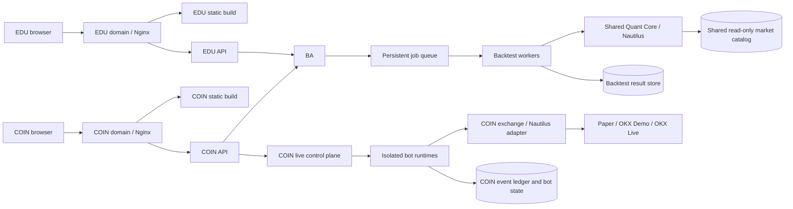

## 17. Prior Executive Summary (Superseded by Section 21)
## 18. Prior Migration Status Checkpoint (Superseded by Section 21)
## 19. Prior Continuation Plan (Superseded by Section 21)
## 20. Prior Immediate Task (Superseded by Section 21)
# NoraBT EDU/COIN Separation Blueprint

## 1. Purpose and decisions

This document defines the target architecture and implementation plan for separating NoraBT into two independently operated products:

- **EDU**: learning, public strategies, user profiles, strategy publishing, and educational backtests.
- **COIN**: quantitative research, portfolio, backtests, Paper/Testnet/Live trading, bot operations, and exchange integration.
- **Shared platform**: one versioned Quant Core and one internal Backtest Service used by both products. This is infrastructure, not a third user-facing product.

The separation must exist at browser, domain, API process, session, data namespace, permission, and resource-control levels. EDU must not depend on the COIN API or live runtime. COIN live operations must not depend on EDU. Both products may depend on Backtest Service for new backtests; if it is down, existing results remain readable and existing COIN execution continues.

### Architecture invariants

1. Keep one Nautilus execution/backtest engine implementation. Never fork strategy, fee, fill, portfolio, or metric logic.
2. UI is presentation only. Backend services validate inputs and own business rules and financial calculations.
3. Heavy computation never runs in an API request process. APIs admit work and return a job ID; isolated workers compute.
4. Only COIN execution services may read exchange credentials or create/stop bots.
5. Every job, result, strategy, bot, ledger event, and audit event has a product/owner namespace.
6. Shared market data is read-only to EDU, COIN APIs, and backtest workers. A designated ingestion process is the writer.
7. Product failure must not take down the other product. Backtest failure may pause new backtests, but not login, existing result reads, or healthy COIN execution.
8. Results are reproducible: preserve engine, strategy, data, parameters, fees, slippage, funding, and runtime provenance.
9. Migration never silently reassigns bot ownership, capital, user identity, or result ownership.

## 2. Historical baseline before child-project extraction

The system is still a runtime monolith:

- `backend/main.py` constructs one FastAPI app, includes all route groups, starts the job lifecycle thread, and serves one `frontend/dist`.
- `backend/routes/__init__.py` combines Studio, Live, Data, and System routers. EDU endpoints are included through System; Live is in the same app.
- `frontend/src/App.jsx` hosts `/edu` and `/coin`, login, and both layouts in one SPA with one `UserProvider`.
- `frontend/vite.config.js` creates one build and proxies `/api`, `/charts`, and `/ws` to port 18010.
- `ops/nginx/nora.expsolution.io.conf` serves one build and proxies `/api/` to the one API upstream on port 18010. Cloudflare currently terminates TLS.
- `ops/systemd/nora-api.service.in` defines one API service. Heavy job subprocesses use `ops/run_limited.sh` and `nora.slice`; the slice currently sets MemoryMax 10G and MemoryHigh 9G. Some comments describe different limits, so actual resource budgets must be measured and reconciled before splitting.
- `backend/jobs/runner/runner.py` owns job launch/status/cancel and starts child processes. `backend/jobs/tasks.py` has job entrypoints, including backtest and live bot work. Live jobs use the same subsystem with special no-lock behavior.
- `backend/routes/live.py` owns bot endpoints and performs live confirmation, strategy/backtest validation, and master-capital admission. The live supervisor currently starts from the combined API lifecycle.
- Shared calculation surfaces include `backend/core/engine.py`, `backend/core/backtest.py`, `backend/analys/`, `backend/data/`, `backend/jobs/`, and `backend/models/`.

Thus `/edu` and `/coin` are currently presentation separation only, not independent applications, sessions, APIs, or runtime failure domains.

## 3. Target topology



| Plane | Owns | Must not own |
|---|---|---|
| EDU | EDU UI/API, users/permissions/content, EDU strategy records | Exchange secrets, bot control, COIN portfolio/ledger |
| COIN | COIN UI/API, portfolio, risk admission, bot controls, live runtime, exchange secrets | EDU private user/content data |
| Shared Backtest | Queue, worker scheduling, immutable job inputs/results, engine invocation | Product login, browser sessions, exchange credentials, bot control |
| Shared Quant Core | Market-data interfaces, strategy contract, signal, engine, fees/fills, metrics | User identity, HTTP/session, product authorization, live secrets |

EDU and COIN are independently deployable/restartable. Shared Backtest is a deliberate dependency for backtests, not a reason to recombine product APIs.

## 4. Domains, Nginx, and API routing

### Proposed hostnames

Subject to DNS/Cloudflare approval:

- `nora.edu.expsolution.io` -> EDU frontend and EDU API routes.
- `nora.coin.expsolution.io` -> COIN frontend and COIN API routes.
- Keep `nora.expsolution.io` as a legacy entrypoint during migration. Retire only after old links and clients have an approved redirect/retirement policy.

Use same-origin browser paths; Nginx selects upstream by host and path:

| Host/path | Upstream | Notes |
|---|---|---|
| EDU `/`, static assets | EDU build directory | SPA fallback for frontend paths only |
| EDU `/api/*` | EDU API on loopback | EDU auth, users, content, publication |
| EDU `/api/v1/backtests/*` | EDU API on loopback | Product API authenticates/authorizes, then calls Backtest API privately |
| COIN `/`, static assets | COIN build directory | Independent build/cache namespace |
| COIN `/api/*` | COIN API on loopback | Portfolio, research, data admin, bot controls |
| COIN `/api/v1/backtests/*` | COIN API on loopback | Product API authenticates/authorizes, then calls Backtest API privately |
| COIN `/ws/*` | COIN API/event gateway | WebSocket upgrade only where needed |
| COIN `/charts/*` | COIN API/chart service | Preserve only while current clients use it |

All app upstreams bind to loopback. Do not expose worker, queue, result filesystem, market catalog, or live runtime ports publicly.

Nginx requirements:

- Separate server blocks, logs, static roots, and upstreams for EDU and COIN.
- Preserve Cloudflare real-IP/TLS policy, but source trusted proxy ranges from a managed/current list.
- Hashed Vite assets may be immutable; HTML/runtime config must be revalidated during rollout.
- Apply route-specific body limits. Backtest submissions carry parameters/references, not candles or result blobs.
- Backtest requests return a job ID quickly; do not rely on long synchronous requests through Cloudflare.
- Configure WebSocket upgrade only on COIN routes that need it.
- Prefer same-origin routing. Replace current wildcard CORS with explicit origins only where cross-origin access is unavoidable.
- Expose health checks without exposing debug/operational endpoints.

Keep the old monolith active initially. Later redirect old frontend paths to their product domain while preserving query strings/deep links; retain old API behavior through a compatibility adapter until access logs and client checks show it is unused.

## 5. Product responsibilities and business logic

### EDU

EDU owns home, login/logout, profile, learning content, public strategy/catalog pages, publication/moderation, educational samples, EDU roles/entitlements/quotas, audit records, and submitting/reading authorized educational backtests.

EDU does not own live/Paper/Testnet controls, exchange connectivity, COIN portfolio/master capital, bot state, OKX keys, or COIN private strategies. It must not have a private engine, signal evaluator, fee model, or metrics implementation.

### COIN

COIN owns portfolio and risk settings, alpha research/catalog, data administration, backtest workflows, Paper/Testnet/Live environments, bot lifecycle, trade/equity views, COIN permissions, capital allocation, event ledger, and exchange-secret references. The browser requests actions through COIN API; it never talks directly to an exchange.

### Shared platform

Product APIs own principal-to-resource authorization. Shared services validate signed service identity and product scope; never trust browser-supplied `owner_id`, product, result path, or storage path.

## 6. Frontend separation

Create two independent Vite entrypoints/builds:

```text
frontend/
  index.edu.html
  index.coin.html
  src/
    edu/{main.jsx,App.jsx,api.js,auth/,pages/,components/}
    coin/{main.jsx,App.jsx,api.js,auth/,pages/,components/}
    shared/{ui/,charts/,formatting/}
```

Build to separate outputs such as `frontend/dist/edu` and `frontend/dist/coin`; use distinct dev ports and API proxies. `shared/` is only product-neutral UI, chart rendering, formatting, and helpers, not navigation, authorization, or business rules.

| Current UI | Target |
|---|---|
| `src/pages/edu/*`, `EduLayout` | EDU app |
| Home and Login | Product-specific screens/flows; share neutral components only |
| `Portfolio`, `Live`, `History` | COIN app |
| `Backtest`, `Studio`, `AlphaCatalog` | COIN first; EDU gets limited backtest/public-strategy screens as required |
| `UserProvider`, `api.js` | Product-specific auth/API clients; neutral transport helpers may be shared |

Each app owns its router and boot process. EDU bundle must not include COIN live components/API controls and vice versa. Route guards are UX, never the authorization boundary.

## 7. Backend service boundaries and mapping

Do not move/rename files only to create the appearance of separation. First add distinct app composition roots and dependency boundaries; move code after ownership and tests are clear.

Suggested target organization:

```text
backend/
  apps/{edu.py,coin.py,backtest.py}
  services/{identity/,edu/,coin/,backtests/}
  jobs/runner/                  # existing worker/runner extracted behind service
  jobs/tasks.py                 # calculation entrypoints, no HTTP/session dependencies
  core/                         # engine and genuinely shared primitives
  analys/                       # signal, alpha, validation, metrics
  data/                         # market catalog interface and ingestion
  adapter/                      # COIN-only exchange/Nautilus integration
  models/                       # schemas/storage adapters with explicit roots
```

| Existing code | Target owner |
|---|---|
| `backend/main.py`, `backend/routes/__init__.py` | Transitional composition; split into EDU, COIN, Backtest factories; remove combined root last |
| `backend/routes/system.py` | Split EDU user/education from COIN/system health and shared operational endpoints |
| `backend/routes/live.py`, `backend/adapter/exchange.py`, `backend/jobs/live_supervisor.py` | COIN only |
| `backend/routes/studio.py` | Split product request/authorization from shared calculation/job submission |
| `backend/jobs/runner/runner.py`, `backend/jobs/tasks.py` | Shared during transition; Backtest service later owns calculation jobs, COIN owns bot lifecycle jobs |
| `backend/core/engine.py`, `backend/core/backtest.py`, `backend/analys/`, `backend/data/data.py` | Shared Quant Core/data interfaces; no HTTP, cookie, or secret dependencies |
| `backend/core/portfolio.py` | Separate pure simulation/risk primitives from COIN master-ledger/live admission state |
| `backend/models/storage.py` | Replace implicit global paths with injected roots and explicit ownership |

Composition rules:

- `edu_app` registers EDU routes/auth and a Backtest client; it does not import live routes, exchange adapter, or live supervisor.
- `coin_app` registers COIN routes/live controls and calls Backtest API; it cannot write another product's job namespace.
- `backtest_app` exposes only job submission/status/result/cancel and health. No arbitrary file paths or bot endpoints.
- Workers call calculation code, never FastAPI routers. Quant Core imports without product auth or live credentials.
- Shared schemas live in a neutral contract module; product request models can be stricter.

## 8. Identity, authorization, and secrets

The current SPA uses one `UserProvider` and shared login flow. Target requirements:

- EDU and COIN have separate product sessions and permission scopes. Use host-only cookies (`edu_session`, `coin_session`), `Secure`, `HttpOnly`, and appropriate `SameSite`; never set a parent-domain cookie to share sessions.
- Shared identity primitives/IdP are acceptable, but tokens need explicit audience (`edu` or `coin`), issuer, expiry, and product roles. SSO does not imply shared authorization.
- Review current handle/name login and session creation, expiry, revocation, CSRF, identity verification, and audit behavior before reusing it.
- APIs derive principal/product only from verified session/token and authorize every operation, including job/result access. A job ID is not authorization.
- Backtest API accepts product-to-service credentials or signed short-lived service assertions. Product/principal are bound at job creation and immutable.
- Cookie-authenticated writes require CSRF protection. CORS is not authorization.
- OKX credentials are readable only by COIN execution identity. They never enter EDU environment, job parameters, results, logs, or shared worker environment.
- Live mode requires server-side role checks and explicit confirmation; UI confirmation alone is insufficient.

## 9. Backtest Service and job logic

### Responsibilities and submission flow

Backtest API owns admission, idempotency, queue state, status, cancellation, result authorization, and retention. Workers compute. Quant Core owns calculation semantics. Product APIs own user authorization and product policy.

1. Browser submits to its same-origin product API.
2. Product API authenticates, checks entitlement/quota, strategy access, data range, and allowed symbols.
3. It sends a versioned request to Backtest API with signed service identity, product, principal ID, request ID, and idempotency key. No secrets or file paths are passed.
4. Backtest API validates/normalizes, hashes canonical request/strategy, checks resource limits, and creates an immutable job record.
5. It atomically enqueues and returns `202 Accepted`, `job_id`, and status URL.
6. Worker claims with a lease, verifies engine/data/strategy versions, then runs the existing Nautilus path within process/cgroup limits.
7. Worker emits progress/heartbeat/logs. Cancellation marks `cancel_requested`, signals the process group, flushes resumable state, then records final state.
8. Worker writes artifacts atomically. Success is published only after result schema, provenance, and checksum validate.
9. Product API checks ownership before returning status/result. Results are immutable; reruns get new job IDs.

### State machine

```text
accepted -> queued -> running -> succeeded
                    |     |----> failed
                    |     |----> cancel_requested -> cancelled
                    |     |----> lease_expired -> queued (bounded retry)
                    |     |----> timed_out
                    |     `----> paused (explicitly resumable kinds only)
                    `----------> rejected (validation/quota)
```

Terminal states are immutable. Retry creates an attempt only when deterministic/safe; otherwise create a new job. Never automatically retry arbitrary custom code or external side effects. Backtests must not perform exchange actions.

### Initial API contract

```text
POST   /api/v1/backtests
GET    /api/v1/backtests/{job_id}
GET    /api/v1/backtests/{job_id}/result
POST   /api/v1/backtests/{job_id}/cancel
GET    /api/v1/backtests/{job_id}/events   # optional; polling is fine initially
GET    /internal/health
```

Submission includes schema version, strategy reference/source hash, allowed parameters, symbols, timeframe, interval, capital/risk model, and execution-cost model. Server derives owner/product from verified service assertion. Reject unknown fields, unbounded ranges/workers, paths, and Python import paths.

Job/result provenance includes:

```text
job_id, product, principal_id, request_id, idempotency_key
status, timestamps, attempt, worker_id
engine_name/version, code_revision, strategy_id/version/hash, params_hash
data_catalog_version/hash/manifest, symbols, timeframe, interval
initial_capital, fee/slippage/funding model
result_schema_version, artifact_checksum, warnings, failure_code
```

### Queue, storage, and fairness

- Queue metadata is durable and supports atomic claim, lease expiry, cancellation, and bounded retries. For one host, transactional SQLite-WAL is a reasonable first option if only one queue coordinator is supported; alternatively use an already-operated PostgreSQL/Redis. Local files plus an in-process lock are not a multi-host queue.
- Keep existing artifacts during migration. Namespace new data as `data/backtest/jobs/{edu|coin}/{job_id}/` and `data/backtest/results/{edu|coin}/{job_id}/`.
- Only worker/result service writes artifacts. APIs use a storage interface, never arbitrary paths.
- Apply separate EDU/COIN concurrency and memory quotas; reserve a COIN research budget if needed. EDU bursts cannot starve COIN. Live processes have a separate budget and never queue behind backtests.
- Start single-host unless multi-host is required. Multi-host needs shared durable storage, distributed leases, and tested duplicate-execution behavior.
- Define retention/deletion by product and status. Do not delete artifacts referenced by visible results or bot provenance.

### Calculation integrity and custom code

- Backtest and Paper/Testnet/Live strategy execution use the canonical Nautilus path. Optimize worker scheduling/cache, not by creating a second simulator.
- Preserve closed causal bars and no-lookahead behavior. Synthetic/fill bars follow one canonical policy and are recorded in provenance.
- Fees, slippage, funding, latency, and fill semantics are explicit versioned inputs, not hidden UI defaults.
- Custom source is untrusted. Run in a constrained process with no network/secrets, bounded CPU/RAM/time/output, and narrow data access. If it cannot be sandboxed, EDU is limited to reviewed strategy contracts.
- Backtest results are research outputs, not proof of profitability or authorization for Live.

## 10. COIN portfolio and live execution logic

COIN API is the control plane; each bot runtime is the execution plane. Separate API restart from bot lifecycle where possible.

### Start flow

1. Authenticate COIN principal and require `bot:start` permission.
2. Validate mode (`paper`, `testnet`, `live`); Live needs explicit confirmation and account/environment checks.
3. Resolve versioned strategy and immutable parameters. For picker/custom configs, verify completed backtest ownership and exact strategy/parameter/symbol/book hashes.
4. Perform atomic portfolio admission: available master allocation, per-bot cap, symbol exposure, bot count, concentration, duplicate config, and mode rules. Reservation + bot creation must be one transaction/lock boundary.
5. Persist unique bot ID and `starting` record before runtime launch. Track requested allocation separately from cash, equity, realized/unrealized PnL, and reserved capital; never double-count.
6. Runtime loads only mode-specific credentials, starts Nautilus node/adapter, records heartbeat, and marks `running` only after connectivity/readiness checks.
7. Every order passes the same server-side risk gate immediately before submission. Fail closed on stale market data, invalid position, breached limits, or ledger persistence failure.
8. Record order intents, acknowledgements, fills, fees, funding, positions, equity, and risk decisions as append-only events. Derive views and reconcile with exchange state.

### Stop, failure, and recovery

- Stop is idempotent and records actor, time, mode, and close/retain-position policy.
- Block new orders first, apply position policy, flush ledger, terminate process group gracefully, and verify exit.
- `running` alone is not proof of execution. Health requires process identity, recent heartbeat, node readiness, and event/market-data freshness.
- Resume uses persisted config/checkpoint provenance; never silently re-enter. Reconcile exchange positions and ledger before enabling orders.
- COIN API/Backtest outages do not automatically stop healthy runtimes. On control-plane loss, no new risk-increasing orders; preserve/reconcile exposure, alert, and retain operator stop path.
- Paper, OKX Demo/Testnet, and Live have distinct credentials, data, ledgers, risk caps, and audit events.

### Ledger invariants

- One authoritative event source per mode; snapshots are derived/cacheable.
- Master/sleeve allocation, reserved capital, cash, equity, PnL, and fees are distinct fields with documented equations.
- Each launch reserves once; stop/rejection releases once; duplicate requests are idempotent.
- Risk limits are enforced in the common order path, not only in UI/start validation.
- Migration preserves bot IDs, mode, allocation, event order, and provenance. Reconcile legacy JSON/manifests before new writes.

## 11. Data ownership and storage

Example target layout:

```text
data/
  market/                  # shared catalog; ingestion identity writes
  backtest/queue/          # queue metadata
  backtest/jobs/edu/{id}/  # EDU inputs, progress, logs
  backtest/jobs/coin/{id}/ # COIN inputs, progress, logs
  backtest/results/edu/{id}/
  backtest/results/coin/{id}/
  edu/                     # EDU profiles/content/publication
  coin/                    # COIN portfolio configuration/metadata
  live/                    # current bot state during migration; COIN-only
  archive/                 # read-only legacy data until sign-off
```

Inventory real directories before copying; never move files while old processes write. Use least-privilege identities: EDU cannot traverse `data/live`; COIN cannot read EDU-private content; worker reads market and writes only job/result namespaces; ingestion alone writes market catalog.

Start with read-only compatibility adapters over existing JSON/Parquet. Add new writes only after source of truth is defined. Migrate by copy, checksum, record count, and reconciliation; switch readers, then retain old data read-only through rollback window.

## 12. Runtime services and resource isolation

Proposed units/loopback ports (confirm availability before installation):

| Service | Unit | Port | Owns |
|---|---|---:|---|
| EDU API | `nora-edu-api.service` | 18020 | EDU HTTP/auth/content |
| COIN API | `nora-coin-api.service` | 18010 initially | COIN HTTP, portfolio, bot control |
| Backtest API/coordinator | `nora-backtest-api.service` | 18030 | Job contract/lifecycle |
| Backtest worker | `nora-backtest-worker.service` | none | Isolated heavy calculations |
| Market ingestion | `nora-market-data.service` or scheduled job | none | Catalog writes/crawl |
| COIN live supervisor | `nora-coin-live-supervisor.service` | none | Bot health/restart policy |
| Per-bot runtime | transient unit/scope | none | Bot execution and limits |

COIN may keep 18010 at first to simplify cutover. New HTTP services bind to `127.0.0.1` and use dedicated identities, working directories, secrets, restart/kill policies, task limits, and systemd slices/cgroups.

Resource policy:

- Measure peak RSS/CPU for APIs, worker classes, ingestion, and bots. Existing slice comments and values disagree; do not copy comments as budgets.
- Reserve memory/CPU for live bots and system operation before assigning the remainder to backtests.
- EDU and COIN APIs have separate slices; workers have a bounded slice/concurrency; bot scopes are isolated by bot or bounded group.
- Worker OOM/restart cannot kill APIs or live bots. Configure BLAS/Numba/Arrow thread limits and log effective settings.
- Separate liveness from readiness. Queue outage must not make API liveness fail; readiness reports dependency state.

## 13. Observability and operations

Structured logs include request ID, product, authorized principal, job/bot ID, service version, and correlation ID. Never log secrets, cookies, credential-bearing environments, or arbitrary strategy source.

Monitor per-product API availability/latency/errors/auth; queue age/depth by product, worker RSS/duration/retries/cancels; bot heartbeat/readiness/data freshness/last fill/ledger lag/exposure/reconciliation drift; and catalog freshness. Audit login/session changes, publishing, job submit/cancel/result reads, bot start/stop, risk changes, and credential changes.

Alerts distinguish product/API, shared Backtest, and COIN execution incidents. Provide runbooks for bot stop, worker drain, queue recovery, result restore, and legacy rollback.

## 14. Migration phases, gates, and rollback

Do not bundle UI redesign, engine refactor, auth replacement, and live-ledger migration into one release.

### Phase 0: inventory and freeze interfaces

- Inventory routes, frontend calls, session behavior, data dirs, systemd/Nginx, active jobs/bots, and secret files.
- Record route ownership, data ownership, and old API callers; capture baseline tests and bot/portfolio snapshots.
- No bot restart or data move in this phase.
- Gate: domains, ports, resource envelope, auth decision, owners, and rollback owner approved.

### Phase 1: explicit app composition

- Extract EDU, COIN, and transitional combined app factories without changing endpoint behavior.
- Ensure each lifecycle hook runs once; avoid duplicate supervisors across apps.
- Add route tests proving EDU has no live endpoints and COIN excludes private EDU operations.
- Gate: baseline tests and route inventory pass; combined app still deploys. Rollback is to continue using combined app; no data moved.

### Phase 2: frontend builds and domains

- Create separate entrypoints/routers/API clients/output dirs; share neutral components only.
- Add EDU/COIN Nginx hosts and DNS; use same-origin API paths and explicit websocket routing.
- Initially both hosts may use the existing API where necessary, but maintain product-specific clients/contracts.
- Gate: independent bundles, deep links, login/logout, assets/API/WS, and mobile behavior work; legacy host remains. Rollback by repointing Nginx/DNS to old build.

### Phase 3: identity and product API processes

- Create separate sessions/audiences and server authorization. Decide shared identity store vs separate stores; never silently merge accounts.
- Start EDU and COIN APIs in separate services/slices; remove static serving from APIs.
- Keep compatibility routes during migration; replace wildcard CORS.
- Gate: either API can stop without stopping the other; cross-product access/job-ID guessing is denied; only COIN runtime sees secrets. Rollback Nginx upstreams to combined API while preserving verified data adapters.

### Phase 4: Backtest API and workers

- Version request/result contracts and tests before redirecting clients.
- Extract durable queue/worker; initially preserve current Nautilus engine/task semantics.
- Add product namespace, idempotency, auth, quotas, leases, cancellation, provenance, checksums, and retention.
- Route both product APIs through the new service; old endpoints temporarily adapt to it.
- Gate: golden outputs are bit-identical; crash/restart/cancel/duplicate tests pass; queue outage affects only new jobs; results restore and authorize correctly. Never dual-execute one request against two engines.

### Phase 5: COIN live isolation

- Move supervisor lifecycle out of API startup. Run bots in dedicated scopes with COIN-only secrets and limits.
- Preserve bot IDs/events. Reconcile each active bot against process, exchange, ledger, positions, and allocation before cutover.
- Establish stop/drain/recovery procedures before moving active bots.
- Gate: Paper/Testnet lifecycle/reconcile and failure-injection tests pass; API/worker restart does not terminate healthy bot; Live needs explicit operational approval.
- Rollback: leave existing runtimes untouched and return control to old COIN API until parity is proven.

### Phase 6: data migration and legacy retirement

- Copy/checksum/count/reconcile EDU/COIN/job/live data; keep old source read-only through rollback window.
- Move writers one at a time, verify event order/snapshots, remove compatibility readers only after sign-off.
- Retire combined routes, old frontend provider/router, old API paths, and combined unit last.
- Gate: no old-route traffic for agreed observation period, backups restore, data/access reconciliation passes, and runbooks are exercised.

## 15. Verification and definition of done

Functional/contract gates:

- Independent builds contain no other product's routes/live controls.
- Route tables exclude cross-product private operations.
- Auth, logout, expiry, CSRF, role checks, and audience are tested separately.
- EDU/COIN job ownership is correct; cross-product status/result/cancel is denied.
- Backtest rejects unknown fields, excessive ranges, invalid symbols/strategies, path injection, and unbounded resource requests.
- Idempotency, duplicate delivery, lease expiry, retry, timeout, cancel, resume, and immutable terminal state are tested.
- Golden/determinism tests remain unchanged; do not widen numerical tolerances for architecture work.
- Live tests cover confirmation, reservation races, common pre-order gate, duplicate start/stop, stale data, ledger outage, restart reconciliation, and secret isolation.

Isolation gates:

- Stop EDU API: COIN and existing bots continue.
- Stop COIN API: EDU continues; bots follow documented fail-safe policy.
- Stop Backtest: login/content/result reads/healthy bots continue; new backtests return clear retryable failure.
- Exhaust EDU quota: COIN reservation and live budget remain available.
- Kill a worker: API stays responsive, job is recoverable, no duplicate result is published.
- Restore product data/results from backup and verify ownership/checksums.

The split is done only when EDU and COIN have separate builds, domains, APIs, sessions, service identities, resource budgets, and data permissions; EDU cannot access bot controls/secrets/COIN ledger; COIN bot operations survive EDU/Backtest outage; both share one versioned engine/contract; ownership/provenance/recovery are verified; and legacy routing is removed only after the approved observation window.

## 16. Decisions to confirm before implementation

- Final DNS names and Cloudflare ownership for EDU and COIN hosts.
- Separate product accounts or shared IdP with separate memberships/audiences.
- EDU strategy execution: reviewed contracts only or sandboxed arbitrary Python.
- Whether public strategies and market catalog may be shared; publication ownership.
- Single-host initial operation or near-term multi-host requirement; queue/storage choice depends on this.
- Resource budgets based on measured service/bot peaks, not current slice alone.
- Result/account/audit retention, backup RPO/RTO, and archived-live-data access.
- Legacy domain/API observation period and retirement approver.

## 17. Executive summary

NoraBT becomes two independent product systems: EDU and COIN each have their own frontend build, domain, API, identity scope, data permissions, and resource budget. COIN alone owns trading and exchange credentials. An internal Backtest Service and one shared Quant Core avoid duplicated calculation logic while isolating heavy work. Migration proceeds in reversible phases: app composition, frontend/domain, APIs/auth, backtest queue/workers, live runtime, then data ownership and legacy retirement. Active bots and financial records are reconciled throughout; engine rewrite and live cutover are not bundled into the first separation release.

## 18. Current Migration Status (2026-10-22)

The repository now contains the legacy system and partial child projects. This is ongoing migration, not a production cutover.

| Workstream | Status | Evidence and remaining gate |
|---|---|---|
| Legacy/runtime baseline | Inventory reports `nora-api` active on 18010 and root `nora-edu` active on 18020; `nora-coin` installed but not started because legacy holds 18010. Proxima bot is recorded stopped. | Inventory is a snapshot, not a live systemd check. Recheck units, listeners, jobs, bots and capital before any operational change. |
| `nora/coin` backend | Import passes in Python 3.12; 101 OpenAPI routes, Live present, EDU routes absent. | Run child tests and prove all runtime reads/writes use `coin/data`. |
| `nora/coin` frontend | COIN entrypoint/router and child build files exist. | Source still has EDU files; prove COIN build is pruned and works from child directory. |
| `nora/coin` ops | Child unit and Nginx vhost exist. | Unit takes 18010, which conflicts with legacy; complete child deploy/rollback workflow is absent. |
| `nora/edu` backend | Allow-list router exists, but child import fails: `ImportError: cannot import name 'DslError' from backend.analys.signal`. Child `backend/jobs/` is absent, while copied Studio code imports it. | Fix import closure entirely within EDU; do not depend on root/COIN backend at runtime. |
| `nora/edu` backtest | Strategy discovery/validation/compiler helpers exist. | No complete EDU submit/worker/result path or golden parity test. |
| `nora/edu` frontend/tests/ops | Child directories are empty. | Build its own frontend, tests, unit, Nginx config and operating scripts. |
| Data migration/parity | Child roots contain OKX catalog directories and entrypoints set `NORA_DATA_ROOT` to child data. | Catalog freshness/checksums, user/alpha/result reconciliation and market-data ownership are unverified. |
| Identity/security | Child copies still use shared user/session patterns. | Separate audience/authorization, signing policy, CSRF and cross-product ownership tests. |
| Domains | Canonical target is `nora.coin.expsolution.io` and `nora.edu.expsolution.io`. COIN child vhost recognizes `nora.coin`; root EDU vhost is still `edu.nora`; no EDU child vhost exists. | DNS/TLS/public routing is not live-verified; root deploy scripts still target root builds/services. |
| Legacy retirement | Root code, data, service and apex vhost remain. | Keep as rollback until child apps, data, domains, bots and old-client traffic pass gates. |

COIN is relatively advanced but still conflicts with legacy on its final port and needs data/deployment cutover. EDU is not yet importable or independently runnable. The recorded service state above comes from `INVENTORY.md`; live systemd/DNS checks were unavailable during this audit and must be repeated on the host.

## 19. Continuation Plan From Current Tree

Do not cut over public traffic while EDU import fails or COIN conflicts with legacy on port 18010.

### Phase A: Freeze and Verify the Live Baseline

- On the host, record systemd state, PIDs, listening ports, Nginx enabled symlinks, public DNS/TLS, active jobs, bot health, and timestamped portfolio/bot snapshots.
- Reconfirm the inventory's stopped Proxima bot and capital figures against live files/API. Do not start/stop bots or move live data during this check.
- Back up root data, env files, active unit files and Nginx config; record checksums and restore steps.
- Gate: there is a named rollback target and legacy can be restored without either child project.

### Phase B: Make EDU Importable and Runnable

- Resolve the observed `DslError` mismatch by comparing EDU signal exports with its compiler/strategy imports. Keep changes inside `edu/backend`; never import `coin/backend` or root `backend` at runtime.
- Close the import graph. Add only the job functions EDU needs, or extract safe EDU use cases so they do not import the full Studio module. Do not include Live, exchange adapters, COIN ledger or bot supervisor.
- Implement strategy contract/source validation -> signal -> canonical Nautilus adapter -> explicit fees/fills -> metrics/provenance -> bounded job lifecycle. No exchange side effects or secret access.
- Decide whether EDU has a pinned engine copy or uses a neutral shared package. If copied, pin source revision and require golden parity tests to prevent silent drift.
- Gate: import succeeds from `nora/edu` using only EDU paths; route tests exclude Live/order controls; a real EDU backtest returns a result and passes golden parity.

### Phase C: Complete Each Child as a Deliverable

- Build `edu/frontend` with its own index, EDU router/API client, package/build config and assets. Use product-root paths, not `/edu/*`.
- In `coin/frontend`, build from `main.coin.jsx` and prove shipped chunks contain no EDU pages/routes; remove unused EDU files after checking imports.
- Add per-project README, start/stop/test/build/deploy scripts and reviewed requirements/lock files. Add tests under both child projects.
- Gate: from each child directory, install, app import, tests, build and preview pass without parent source paths.

### Phase D: Migrate Data Without Split-Brain

- Checksum/compare root and child market catalogs, alpha/user records, results, jobs and live state. Compare Parquet manifests, instrument counts and representative queries.
- Choose one market-data policy: one read-only catalog with a single ingestion writer, or separately versioned copies with explicit sync. Never let both products write the same catalog.
- Copy/reconcile users, strategies and results; switch readers; keep root data read-only during rollback. Keep live state COIN-only and never copy secrets into data/jobs.
- Gate: reconciliation passes, each product reads the intended catalog/version, and rollback cannot discard writes.

### Phase E: Finish Identity and Authorization

- Choose separate product accounts or shared identity with explicit product memberships and distinct roles.
- Use host-only sessions and separate signing/audience scopes. Authorize every endpoint and job/result lookup.
- Test EDU credentials against COIN and vice versa, job/result ID guessing, CSRF, logout/revocation and public strategy access.
- Remove wildcard CORS; same-origin Nginx routing is the default.
- Gate: cross-product credentials/IDs are rejected; EDU cannot operate bots or read COIN ledger/secrets.

### Phase F: Stage Services on Non-Conflicting Ports

- Keep legacy on 18010. Stage COIN on 18012 and EDU on 18022, or other verified-free ports, using child-owned units/configs.
- Add EDU unit and project-specific operating scripts. Bind APIs to loopback; use separate env files, service identities/permissions, logs and resource slices. EDU must not load `okx.env`.
- Ensure one cleanup/supervisor owns each namespace. Bot runtimes must not be duplicated or killed by API restarts.
- Gate: restart either staged API without affecting the other or legacy; verify ports and secret visibility. Do not route public Nginx to staging before this passes.

### Phase G: Cut Over Canonical Domains

- Add/verify DNS and TLS for `nora.edu.expsolution.io` and `nora.coin.expsolution.io`; create EDU vhost under EDU ops and route each domain to its child build/upstream.
- Health checks must verify `product`, not merely HTTP 200. Test login, deep links, refresh, assets, API, WebSocket where needed and cookie scope externally.
- Keep apex on legacy until both products pass. Then retire/redirect apex only by approval, preserving old links/query parameters.
- Before COIN takes port 18010, stop/disable legacy in a controlled window and confirm the port is free. Preserve old unit/config for rollback.
- Gate: public DNS/TLS and HTTP checks pass; rollback is rehearsed; apex changes only after approval.

### Phase H: Observe and Retire Legacy

- Run child suites, EDU golden parity, auth/route isolation, worker crash/cancel and bot-safe restart tests.
- Observe old-domain/API traffic; reconcile user/alpha/job/result/live counts; verify backup restore.
- Retire root compatibility routes/services only after the agreed observation period and zero active bot/job/client/data-writer dependencies.
- Gate: both child projects independently install/build/test/deploy/restart; domains and data ownership reconcile; recovery is rehearsed; legacy dependencies are zero.

## 20. Immediate Next Task
## 20. Immediate Next Task
Do not start domain cutover yet. First complete EDU import closure and a real EDU backtest. Stage COIN only after host baseline and data ownership are verified. Keep legacy service/data intact until gates pass.

## 21. Master Plan Based on Latest Report

This is the current execution checklist and supersedes older status/next-step statements. A file or passing import/build test does not prove a worker, service, vhost, DNS record, or public product is running.

### 21.1 Verified checkpoint

| Area | Report/check result | Still unproven |
|---|---|---|
| Host | Report says legacy remains on 18010; child staging is assigned 18012/18022. | Command outputs were not included. Reconfirm active units/PIDs/listeners/bots/jobs before host action. |
| COIN backend | Import and route test pass: 101 paths, Live present, EDU absent. | Full suite, data-write containment, active service. |
| EDU backend | Import/route test pass: 36 paths. The latest test directly calls `run_custom()` on OKX catalog candles; source call path reaches `PortfolioEngine`/`NautilusRun` and Nautilus `BacktestEngine`. | No HTTP backtest/job route; the test bypasses API, queue, local runner and result retrieval. No golden comparison. |
| EDU jobs | `live_bot` is absent from EDU `KINDS`, direct call raises `PermissionError`, and local `edu/ops/run_limited.sh` exists and is executable. | No harmless job has been shown passing through `launch()` and the local runner. The runner shares `nora.slice`, so separate file locks do not isolate total RAM/CPU. |
| Frontend | Report says both builds pass. | EDU `node_modules` symlink points to root; clean dependency isolation unproven. Routes remain `/edu/*` and `/coin/*`. |
| Ops/domains | Child unit/vhost files exist for 18012/18022 and canonical hosts. | Services/vhosts/DNS/TLS not proven active. Both services still share `nora.slice`; EDU and COIN jobs can contend for its aggregate budget. |
| Auth | Product cookie names exist. | Handle/name login remains; signing secret is shared and token lacks audience. Gate public exposure or replace auth. |
| Data | Child data roots/catalog trees exist. | Full checksum/count/freshness reconciliation and one market-data writer unverified. |

### 21.2 Workstream 0: baseline and rollback

- [ ] Capture systemd status/show for legacy, root EDU and child services; record `MainPID`, `ExecStart`, unit path and active state.
- [ ] Capture listeners on 18010, 18012, 18020 and 18022; identify each owner.
- [ ] Query `/api/health` on active ports and require the expected `product`, not just HTTP 200.
- [ ] Check Nginx enabled links, `nginx -t`, public DNS/TLS and Host-header routing.
- [ ] Reconcile bot processes/IDs/modes, jobs, capital and ledger snapshots. Do not restart bots or move data.
- [ ] Back up root/child data, env files, units and Nginx configs; record checksums and restore steps.
- **Done:** legacy is healthy/unchanged, staging ports are free, baseline is restorable.

### 21.3 Workstream 1: EDU import closure and job boundary

- [ ] Test import from `nora/edu` with only EDU on `PYTHONPATH`; assert imported modules do not resolve under root `nora/backend` or `nora/coin/backend`.
- [x] Keep the live stub; remove `live_bot` from EDU `KINDS` and exports; assert direct submit is rejected before queueing.
- [x] Assert EDU routes exclude bot/order/exchange/crawl/COIN portfolio/live-ledger operations.
- [x] Add `edu/ops/run_limited.sh` or an EDU-local runner using EDU working/data roots and limits; never fall back silently to root ops.
- [ ] Assert job/progress/log/result paths stay under `edu/data`; reject traversal and symlink escapes.
- [ ] Launch a harmless EDU job through `launch()` and verify the child runner completes and writes only within EDU data.
- **Status:** live-job deny and local runner checks pass; import-origin and safe-job/path-containment checks remain. Workstream is not fully closed.

### 21.4 Workstream 2: real EDU backtest

- [ ] Define allowed strategy contract/request fields: source/reference, symbols, timeframe/interval, capital/risk and fees/slippage. Reject unknown/unbounded inputs.
- [ ] Implement EDU submit/status/result/cancel endpoints. Submit returns `202` plus job ID; computation stays out of API process.
- [ ] Allow only EDU backtest/sample job kinds; no COIN portfolio/book, scans, sweeps, ingestion or live jobs.
- [x] Use the canonical Nautilus execution path and closed causal bars. If modules are copied, pin source/dependencies and record them in results.
- [x] Run one bounded real backtest on the EDU OKX catalog; result generation and Nautilus provenance were reported and the implementation call path reaches Nautilus `BacktestEngine`.
- [ ] Persist that result through the EDU job/result path with immutable engine/source/params/data/cost/schema provenance; current test calls `run_custom()` directly.
- [ ] Compare with source implementation on identical real candles/params; document deliberate differences, do not widen tolerances.
- [ ] Test idempotency, cancel, worker crash, timeout, result ownership and cleanup. Worker has no exchange secret/side effect.
- **Status:** engine-level real execution is demonstrated. API submit -> worker -> progress -> authorized result retrieval and golden comparison remain; compile-only is not a pass.

### 21.5 Workstream 3: independent project deliverables

- [ ] Replace EDU `node_modules` symlink with lockfile-backed clean install; build without root dependencies.
- [ ] Build COIN from child root; verify `main.coin.jsx` entry and no EDU paths in emitted chunks.
- [ ] Move routes to product roots: EDU `/`, `/login`, `/studio`, `/market`, `/me`, `/u/:handle`, `/s/:id`; COIN `/`, `/login`, `/portfolio`, `/backtest`, `/alpha/*`, `/live`, `/history`.
- [ ] Redirect old `/edu/*`, `/coin/*`, `/education` and legacy paths to correct canonical host/path, preserving query strings.
- [ ] Add each project's README, pinned dependencies, tests, start/stop/build/test/deploy scripts and health metadata; correct stale domain/port comments.
- **Done:** clean install/import/test/build/preview passes inside each child, bundles contain only that product.

### 21.6 Workstream 4: auth and exposure

- [ ] Decide whether staging is gated by Cloudflare Access or login is replaced before public exposure. Handle/name entry can impersonate accounts; it is not production auth.
- [ ] Use separate signing secrets or an enforced signed audience/product claim; cookie names alone do not isolate tokens.
- [ ] Test host-only Secure/HttpOnly cookies, CSRF, expiry/revocation, logout and forwarded-proto handling.
- [ ] Test EDU credentials against COIN and vice versa, job/result ID guessing and unauthorized strategy writes.
- [ ] EDU env must not load `okx.env`; exchange credentials are inaccessible to EDU and backtest workers.
- [ ] Remove wildcard CORS; prefer same-origin Nginx paths.
- **Done:** approved auth or access-gated staging; cross-product credentials/data access denied.

### 21.7 Workstream 5: data parity and ownership

- [ ] Produce root/coin/edu catalog manifests: file/instrument counts, date range, Parquet manifest/version and checksums.
- [ ] Choose one market-data policy: shared read-only catalog with a single writer, or independently versioned copies with controlled sync.
- [ ] Reconcile users, strategies, samples, results, jobs and live records; document what migrates to each product.
- [ ] Switch child readers only after parity; keep root read-only through rollback/soak.
- [ ] Keep live ledger/bot data COIN-only; never put credentials in EDU/jobs.
- **Done:** approved reconciliation report and verified per-product read/write roots.

### 21.8 Workstream 6: staging services

- [ ] Keep legacy on 18010; stage COIN 18012 and EDU 18022 after confirming ports free; bind APIs to `127.0.0.1`.
- [ ] Install distinct staging units while preserving rollback units. Verify loaded `ExecStart`, `WorkingDirectory`, env files and data roots via systemd.
- [ ] EDU must not load `okx.env`; use separate service identities/permissions.
- [ ] Add measured resource slices beneath Nora parent budget; reserve headroom for legacy/live bots and prevent EDU starving COIN.
- [ ] Ensure one cleanup/supervisor per namespace; API restart cannot duplicate jobs or stop healthy bots.
- [ ] Start one service at a time; verify product health, routes, logs, job roots and secret visibility; test restart isolation both ways.
- **Done:** both staging services active on intended ports; either can restart without affecting the other or legacy.

### 21.9 Workstream 7: Nginx, DNS/TLS and cutover

- [ ] Check canonical `server_name`, static roots, SPA fallback, loopback upstreams, forwarded headers, body/time limits, COIN WebSocket config.
- [ ] Keep apex on legacy during staging. Enable child vhosts only after service/build gates; run `nginx -t` before reload and verify symlinks.
- [ ] Verify external DNS/TLS for `nora.coin.expsolution.io` and `nora.edu.expsolution.io`; public health must return correct product.
- [ ] Test login/session isolation, product-root deep links/refresh, assets, APIs, EDU backtest and COIN WebSocket if used.
- [ ] Keep old aliases only while needed, then redirect; retire/redirect apex only by approval after stability.
- **Done:** both canonical domains consistently serve their child app/API; apex no longer serves a product after approval.

### 21.10 Workstream 8: soak and legacy retirement

- [ ] Run child suites, import/route isolation, EDU real-backtest parity, auth, cancel/restart/failure, data reconciliation and frontend builds.
- [ ] Observe errors, queue failures, memory, catalog freshness, bot health and legacy traffic for agreed soak period.
- [ ] Rehearse Nginx/upstream rollback and restore a data snapshot. Do not restart a live bot to test rollback.
- [ ] Retire legacy only when no active bot/job/client/data writer depends on it and the owner approves.
- **Final done:** children independently install/build/test/deploy/restart; EDU backtest is verified; COIN/auth/data/secrets are isolated; domains work; apex retired; rollback/reconciliation documented.

### 21.11 Fastest safe parallelization

- Workstream 0 is mandatory before host operations.
- After baseline, run EDU import/backtest (1-2) alongside COIN frontend cleanup (part of 3); do not edit copied backend modules from both lanes simultaneously.
- Run auth (4) and data inventory (5) in parallel; both must pass before public staging.
- Staging (6) precedes DNS/vhost cutover (7); soak/retirement (8) is last.
- If a gate fails, fix that slice and rerun its exact check. Import/build success alone never closes a phase.

Do not start domain cutover yet. First complete **EDU import closure and minimal EDU backtest execution**, because EDU currently fails import and has no frontend/ops/tests. Stage COIN only after the host baseline and data ownership are verified. Keep legacy service and data intact until both gates pass.