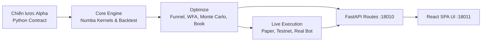

# Kiến trúc tổng thể Nora (Architecture Spine)

Tài liệu xương sống (Spine) định hình toàn bộ kiến trúc kỹ thuật của hệ thống Nora Quantitative Trading System. Các tài liệu đặc tả chi tiết chuyên sâu được phân rã thành các module trong thư mục `architecture/`.

---

## 1. Tầm nhìn & Nguyên lý cốt lõi

Nora là hệ thống giao dịch định lượng chuẩn mực cho thị trường tiền mã hoá (Crypto CEX & DEX). Kiến trúc hệ thống được xây dựng trên 4 nguyên lý thép:

1. **Một Engine duy nhất**: Toàn bộ chu trình từ Backtest nghiên cứu, Paper trading, Testnet đến Live bot chạy bằng tiền thật đều thực thi qua cùng một engine `backend/core/backtest.py`.
2. **Khớp chuẩn NautilusTrader**: Sử dụng ngữ nghĩa khớp lệnh nến nội bar `ohlc` hai pha (Mở nến & Trong nến) triệt tiêu hoàn toàn lookahead bias giữa các tài sản trong danh mục.
3. **Phân tầng nghiêm ngặt một chiều**: $\text{core} \to \text{alpha/metrics/regime/wfa/carlo} \to \text{crawl} \to \text{optimize} \to \text{live/routes}$.
4. **Backend là nguồn sự thật duy nhất**: Frontend React SPA hoàn toàn thụ động, nhận metadata và dữ liệu định dạng từ API `/api/studio/meta`.

---

## 2. Sơ đồ khối tổng thể

---

## 3. Mục lục tài liệu kiến trúc chi tiết

Toàn bộ đặc tả kỹ thuật chuyên sâu được lưu trữ tại `architecture/`:

| Tài liệu | Nội dung chi tiết |
|---|---|
| [source-tree.md](architecture/source-tree.md) | Cây thư mục mã nguồn đầy đủ của Backend, Data, Frontend và Ops (1 dòng/file). |
| [components.md](architecture/components.md) | Kiến trúc 5 phân tầng và sơ đồ luồng dữ liệu end-to-end. |
| [data-models.md](architecture/data-models.md) | Cấu trúc dữ liệu nến `.pkl`, metadata DataFrame `attrs`, và vòng đời bộ đệm Cache. |
| [engine-spec.md](architecture/engine-spec.md) | Đặc tả thuật toán khớp lệnh nội nến hai pha, chi phí thực tế và danh mục chỉ số đo lường. |
| [api-spec.md](architecture/api-spec.md) | Hợp đồng giao tiếp API RESTful giữa FastAPI và Frontend. |
| [coding-standards.md](architecture/coding-standards.md) | 9 luật thép kiến trúc và quy chuẩn phát triển bắt buộc cho AI agent và lập trình viên. |
| [test-strategy.md](architecture/test-strategy.md) | Chiến lược kiểm thử Golden bit-identical, đối chiếu NautilusTrader 332/332 và gating CI. |

### Các quyết định kiến trúc đã phê duyệt (Architecture Decision Records)
- [ADR-P6: Kiến trúc thực thi thống nhất](architecture/decisions/ADR-P6-unified-execution.md)
- [ADR-P9: Tinh gọn kiến trúc Backend & Dữ liệu](architecture/decisions/ADR-P9-backend-layout.md)
- [ADR-P10: Hợp đồng chiến lược Strategy Contract & Trình soạn thảo](architecture/decisions/ADR-P10-alpha-contract.md)
