# Kiến trúc và đặc tả kỹ thuật Nora

Phiên bản: 1.0 · Ngày: 01/10/2026 · Khớp code tại `a3202c9` (nhánh `fix/pipeline-audit`). Đường dẫn tính từ `nora/`.
Yêu cầu sản phẩm ở [prd.md](prd.md); tài liệu chuyên đề: [../data_layout.md](../data_layout.md),
[../signals_strategies.md](../signals_strategies.md), [../alpha_pipeline.md](../alpha_pipeline.md), [../ui_contract.md](../ui_contract.md).

Quy ước: "bất biến" là điều kiện có test giữ; "giả định" là lựa chọn mô hình có thể sai so với sàn thật.

## 1. Sơ đồ ngữ cảnh

```mermaid
flowchart LR
  subgraph SRC[Nguồn]
    BV[data.binance.vision + REST]
    GT[GeckoTerminal - DEX, phụ]
  end
  BV --> CR[crawler + promote_staging]
  GT --> CR
  CR --> D[(data/cex, data/dex<br/>1m.pkl + manifest + funding)]
  D --> QG{quality gate}
  D --> K[kernels causal<br/>+ căn khung avail_time]
  K --> S[tín hiệu AST<br/>strategy_library / strategy_book]
  S --> E[BacktestEngine / PortfolioEngine<br/>PositionTracker + CapitalLedger]
  E --> WFA[WFA<br/>đơn tài sản / danh mục]
  WFA --> MC[Monte Carlo<br/>theo lệnh / theo ngày MTM]
  MC --> HO[Holdout 20% cuối]
  HO --> REG[(data/alphas<br/>registry.json, book.json, testnet/)]
  REG --> API[FastAPI backend.main:app<br/>/api/studio/*]
  E --> API
  API <--> JOBS[[run_limited.sh -> backend.<gói>.<lệnh><br/>nora.slice 12G]]
  API --> UI[UI v2: Danh mục, Backtest, Alpha]
  REG -. chưa có bot .-> TN[Binance Futures testnet / live]
  TN -. feed thật, chưa có .-> API
```



Đường nét đứt là phần chưa làm (epic E9). Hiện tại Live/Testnet của trang Danh mục đọc feed giả lập từ `data/_cache/mock_feeds/`.

## 2. Bản đồ package

| Thư mục | Trách nhiệm | File chính |
|---|---|---|
| `backend/main.py` | App FastAPI (`uvicorn backend.main:app`), CORS, phục vụ SPA từ `frontend/dist`; còn route cũ đọc MySQL (`/api/runs`, `/api/miner/*`...) | `main.py` (2261 dòng) |
| `backend/api/routers/` | Router: `book.py` (sổ, job, mc, publish, alphas), `portfolio.py` (dashboard), `studio.py` (simulate, scan, WFA/MC cũ), `research.py`, `engine.py` (`/api/v2`), `meta.py` | |
| `backend/api/jobs/` | `batch.py` (job nền qua `run_limited`), `store.py` (SQLite: backtest/WFA/MC/scan), `scan.py` | |
| `backend/api/` | `schemas.py`, `control.py` (điều khiển node cũ) | |
| `backend/core/contracts.py` | Hợp đồng pydantic cho WFA/MC/Studio (`WfaFoldConfig`, `MonteCarloRunRequest`...) | |
| `backend/core/data/` | `loader.py` (đọc nến, cache LRU theo byte), `resampler.py`, `quality_gate.py`, `crawler/` | |
| `backend/core/signals/` | `kernels.py` (23 kernel), `evaluator.py` (AST), `diagnostics.py` | |
| `backend/core/strategy/` | `strategy_library.py` (SIGNALS, KERNEL_STRATEGIES, OPTIMIZATION_SPACES), `strategy_book.py` (CANDIDATES, GATES, RISK), `params.py`, `params_template.py`, `templates.py`, `validator.py`, DC | |
| `backend/core/backtest/` | `engine.py`, `execution.py` (`PositionTracker`, `CapitalLedger`), `portfolio.py` (`PortfolioEngine`, `RiskConfig`), `shared_data.py`, `params_builder.py`, `metrics.py`, `portfolio_metrics.py` | |
| `backend/core/analytics/` | `portfolio_dashboard.py` (payload Danh mục), `feeds.py`, `stats_metrics.py`, `queries.py` (MySQL cũ) | |
| `backend/core/research/` | Nghiên cứu thị trường giai đoạn DEX (DC, regime, insight); không thuộc trục chính | |
| `backend/db/` | `data_layout.py` (đường dẫn), `local_pkl.py`, `tick_storage.py`, `models.py`, `mysql.py`, `mongo.py` | |
| `backend/optimize/` | `registry.py` (kho alpha, cấu hình testnet), `book_export.py` (book + publish), `generator.py`, `ranker.py`, `runner.py`, `results_store.py`/`stream.py`/`progress.py`; lệnh `build_strategy_book`, `optimize_alphas`, `run_funnel`, `build_presets`, `build_alpha_registry`, `portfolio_sizing`, `robustness_check`; `funnel/` (phễu S0–FINAL) | |
| `backend/wfa/` | `walk_forward.py` (đơn tài sản), `portfolio_wfa.py` (danh mục), lệnh `validate_book` | |
| `backend/carlo/` | `monte_carlo.py` | |
| `backend/utils/` | `lru.py`, `parallel.py`, `memwatch.py`, `jsonsafe.py`, `jobresult.py` | |
| `backend/utils/ops/` | `run_limited.sh`, `install_user_units.sh`, `check_tests_vs_ref.sh`, `systemd/` | |
| `test/` | pytest, `golden_scenarios.py`, `make_golden.py`, `golden/*.json` | |
| `data/` | dữ liệu và cache; chỉ `data/alphas/` được commit | |
| `frontend/` | Vite + React SPA, cổng dev 18011, proxy `/api` tới 18010 | |

## 3. Dữ liệu

Nguồn: `backend/db/data_layout.py` (đường dẫn), `backend/core/data/*`.

### 3.1 Bố cục và ký hiệu

```
data/cex/<SYM>/{1m,5m,15m,1h,4h,24h}.pkl + manifest.json            # spot
data/cex/<SYM>/perp/{1m,...,24h}.pkl + funding.pkl + manifest.json    # BTC@perp
data/dex/<SYM>/{...}.pkl + manifest.json [+ ticks.parquet, dex_pool.json]
data/_meta/  data/_cache/    # _ và . đầu tên không phải tài sản
```

- `BTC@perp` luôn là `cex/BTC/perp`; ký hiệu perp không bao giờ rơi về spot (`test_instrument_symbol_never_falls_back_to_spot`).
  Chiến lược `market="perp"` mà không có dữ liệu perp thì dùng giá spot với `price_source="spot_proxy"`, `funding_modeled=false`.
- Tên trùng giữa hai venue bắt buộc có tiền tố (`cex:UNI`, `dex:UNI`); không tiền tố thì lỗi (`test_ambiguous_symbol_requires_venue`).
- Vũ trụ sổ chiến lược: `UNIVERSE = [BTC, ETH, SOL, BNB, XRP, DOGE, ADA, AVAX]` → `<SYM>@perp` (`strategy_book.perp_symbols()`).
- Đo thực tế (SOL perp, `data/cex/SOL/perp/manifest.json`): 1.577.881 nến 1m, độ phủ 1095,75 ngày (2023-09-30 đến 2026-09-30),
  `filled_ratio_1m = 0`, `checksums_verified = true`, 36 file tháng + 29 file ngày + 1029 dòng REST.

### 3.2 Manifest

Khoá chính: `venue, exchange, market, source, synthetic, crawl_ok, checksums_verified, start_ts, end_ts, coverage_days,
coverage_ratio, filled_ratio_1m, sha256_1m, rows{khung}, funding{...}, source_files`. `sha256_1m` định danh dữ liệu;
registry ghi lại để chứng minh một kết quả chạy trên đúng dữ liệu nào.

### 3.3 Resample

`backend/core/data/resampler.py`: 1m là nguồn duy nhất; khung khác resample theo UTC, `label="left"`, `closed="left"`, 4h neo 00:00 UTC.
Phút thiếu được điền `close` trước đó, `volume=0`, `is_filled=1`. Hàm điền idempotent (`test_fill_idempotent_*`).
Engine bỏ qua mọi nến `is_filled=1` (CEX perp ≈ 0%, DEX 13-47%).

### 3.4 Quality gate

`backend/core/data/quality_gate.py`, trạng thái `APPROVED | WARNING | BLOCKED | NEEDS_MORE_DATA`.

BLOCKED: thiếu manifest, `synthetic=true`, `crawl_ok=false`, `sha256_1m` lệch với `1m.pkl`, trùng timestamp, `filled_ratio_1m > 0,60`
(`MAX_FILLED_RATIO_1M`), thiếu 4h, resample 1m không khớp các khung đã lưu (sai số tương đối 1e-9). Bước nhảy > 50%/phút:
WARNING với dữ liệu CEX đã kiểm checksum (sự kiện thật, ví dụ 2025-10-10), BLOCKED với DEX. Độ phủ < 30 ngày: `NEEDS_MORE_DATA`.
Kết quả cache trong tiến trình, khoá theo `(mtime_ns, size)` của mọi file tài sản (`test_gate_cache_invalidates_on_file_change`).

**Nơi gate được gọi:** `api/routers/studio.py` (`/simulate`), `api/jobs/scan.py`, `wfa/walk_forward.py` (`execute_wfa_pipeline`),
`core/research/market_analyzer.py`, `market_health.py`, `core/data/promote_staging.py`.
**Cổng bắt buộc cho đường sổ chiến lược (E12.1):** `require_data_ok(symbols)` (cũng `require_data_ok_or_exit` cho CLI) trong `quality_gate.py` ném
`DataQualityError` (tiếng Việt, liệt kê từng tài sản) khi BLOCKED / NEEDS_MORE_DATA; WARNING chạy tiếp và ghi log. Được gọi ở: `PortfolioEngine.load_data`
(mỗi tài sản, dùng cache của gate), đầu `main` của `build_strategy_book`, `validate_book`, `run_book_backtest`, `make_mock_feeds`, và `optimize_alphas`
(trước khi fork pool + tường minh ở `_run_pair` cho giai đoạn sàng lọc). Tiến trình cha gọi trước khi fork nên worker thừa kế cache gate (tránh đọc lại 1m).

### 3.5 Cache nến

`CandleLoader` (`core/data/loader.py`) giữ `_CANDLE_CACHE = ByteLRU(NORA_CANDLE_CACHE_MB, mặc định 1024)`, khoá theo
`(mtime_ns, size_bytes)` của file nên tự hết hạn khi crawl lại; mỗi file chỉ chiếm RAM một lần dù đọc nhiều cửa sổ.
`ByteLRU` (`utils/lru.py`) giới hạn theo byte, có khoá luồng; mục lớn hơn cả ngân sách thì không cache.

## 4. Tín hiệu và AST

### 4.1 Kernel causal

`backend/core/signals/kernels.py`, 23 kernel: `sma, ema, roc, er, adx, rsi, bbz, bbm, bbu, bbl, bbw, bbwp, atr, natr, rv, kcm, kcu, kcl,
dch, dcl, vwap, vwapdev, volz`. Tên cột `<kernel>_<p1>[_<p2>...]` (ví dụ `bbu_20_2`, `dch_20`).

- **Bất biến prefix:** `kernel(df)[:t] == kernel(df[:t])` với mọi t (`test_kernel_is_causal_prefix_invariant`).
  `dch_n`/`dcl_n` là đỉnh/đáy của n nến **trước**, không gồm nến hiện tại, nên `close > dch_n` là breakout hợp lệ.
- Khởi động trả NaN; điều kiện dùng NaN là False (`test_kernel_nan_during_warmup_then_values`).
- Kernel 1m chỉ tính trên các phút có giao dịch (`test_one_minute_kernels_ignore_filled_minutes`).
- Công cụ phát hiện nhìn trước: `test_prefix_check_detects_a_lookahead_kernel` chứng minh phép kiểm bắt được kernel nhìn tương lai.

### 4.2 Căn khung đa khung

`core/backtest/engine.py` (đầu file): với mỗi khung F, đặc trưng tính trên nến F đã đóng, rồi ghép vào dòng 1m bằng `pd.merge_asof`:
`decision_time = open_1m + 1m`, `avail_time = open_F + độ dài F`, `direction="backward"`. Nghĩa là nến 1m đóng lúc T chỉ thấy nến F
đã đóng tại thời điểm ≤ T. `FRAME_MS = {1m, 5m, 15m, 1h, 4h, 24h}`. Trường `{"frame","column","index"}` với `index = k` đọc cột trễ k nến
trên cùng khung (`lag_key`, tối đa 500). Test: `test_higher_frame_kernel_visible_only_after_close`, `test_4h_lookahead_candle_visibility`,
`test_no_lookahead_when_future_modified`.

### 4.3 Bộ đánh giá AST

`core/signals/evaluator.py`: `LogicEvaluator` (từng nến, an toàn) và `VectorEvaluator` (cả chuỗi bằng numpy). Toán tử so sánh
`> < >= <= == = !=`, số học `+ - *` (và `add/subtract/divide`). Cây điều kiện là danh sách các khối AND lồng OR theo cấu trúc
`{"match":[{"condition":[...]}], "stop":[...]}`. `test_vector_evaluator_matches_scalar_on_random_asts` giữ hai bộ cho cùng kết quả.
Ngưỡng tham số hoá `{"param": tên, "default": x}` thay bằng `params_template.resolve_placeholders`; khoá tối ưu `sig.<tên>` (`split_params`).

### 4.4 Thư viện

| Tập | Số lượng | Dùng cho |
|---|---|---|
| `SIGNALS` (`strategy_library.py`) | 8 | kiểm tra tín hiệu, mẫu `/samples` |
| `KERNEL_STRATEGIES` | 8 | scan Studio |
| `OPTIMIZATION_SPACES` | 5 (`dca_reversion_long_perp`, `dca_reversion_short_perp`, `trend_long_perp`, `trend_short_perp`, `dex_dip_reversion_spot`) | `optimize_alphas` |
| `CANDIDATES` (`strategy_book.py`) | 7 (`trend_long`, `trend_short`, `breakout_4h_long`, `breakout_4h_short`, `momentum_long`, `reversion_long`, `reversion_short`) | `build_strategy_book`, `validate_book` |

`strategy_book.materialize(candidate, params)` ghép `BASE_POSITION` (perp, đòn bẩy 10, `exit_unit="atr"`, `atr_frame="1h"`, `atr_period=14`,
`sizing="risk"`, `risk_per_trade_pct=0.5`, `max_notional_pct=300`, `stop_fill="level"`, `cooldown=60`) với tham số ứng viên.

## 5. Engine thực thi (một flow)

Nguồn: `backend/core/backtest/execution.py` (`PositionTracker`), `engine.py`, `params_builder.py`.

### 5.1 Vòng đời một nến 1m có giao dịch

1. **Đầu nến (giá open).** Lệnh thoát chờ (`pending_exit`, do AST `stop` ở nến trước) hoặc hết `timeout` → đóng ở open (taker, trượt giá).
   Lệnh vào chờ (`pending_entry`, do AST `match` ở nến trước) → mở tầng đầu ở open + trượt giá, nếu `can_open` (danh mục cho phép).
2. **Trong nến, phía bất lợi trước.** Sự kiện: tầng DCA kế tiếp (limit), SL, trailing, giá thanh lý (perp). Với long, xử lý mức cao nhất bị
   chạm trước (giá rơi từ trên xuống); với short, mức thấp nhất. Hai mức trùng nhau thì **ưu tiên thoát** (SL, trailing, thanh lý đứng trước DCA).
   Sau mỗi tầng DCA khớp, giá trung bình, SL và giá thanh lý được tính lại rồi lặp lại trong cùng nến.
3. **Gap.** Nếu open đã vượt mức, khớp ở open: `min(level, open)` cho long, `max(level, open)` cho short (`test_gap_through_sl_fills_at_open`).
4. **Phía có lợi.** Chốt lời (limit, từ giá TB) chỉ xét khi trong nến **không** có tầng DCA nào khớp (`test_no_take_profit_in_same_bar_as_dca_fill`);
   khớp ở `max(tp_level, open)` (long) hoặc `min(tp_level, open)` (short), maker.
5. **Cuối nến.** Cập nhật đỉnh/đáy có lợi (`peak`) cho trailing, lỗ treo tối đa (`mae_usd`), rồi đặt `pending_exit` nếu AST `stop` đúng, hoặc
   `pending_entry` nếu AST `match` đúng và hết `cooldown`. Trailing dùng `peak` của các nến trước (`test_trailing_stop_uses_previous_peak`).

Cách khớp SL/trailing (`stop_fill`): `"level"` (mặc định) khớp đúng mức + trượt: **giả định lạc quan** khi giá giật xuyên mức trong nến;
`"extreme"` khớp ở giá xấu nhất của nến (`min(price, low)` long, `max(price, high)` short): cận dưới. Kết quả luôn báo cả hai.

### 5.2 Phí, trượt giá, funding, thanh lý

| Mục | Quy tắc |
|---|---|
| Phí mặc định `VENUE_COSTS` (taker, maker, trượt) | CEX spot 0,10% / 0,10% / 0,02%; **CEX perp 0,05% / 0,02% / 0,02%**; DEX spot 0,30% / 0,30% / 0,10% (phí pool thật từ manifest). DEX không có perp |
| Taker (market, có trượt) | vào lệnh ở open, SL, trailing, timeout, thoát theo tín hiệu |
| Maker (limit, không trượt) | tầng DCA, chốt lời |
| Funding (perp) | mỗi mốc funding ≤ t, `payment = qty × giá_open × rate`, long trả khi rate > 0, short nhận; hạch toán thẳng vào `ledger.equity` |
| Giá thanh lý | long `avg × (1 − 1/L + mmr)`, short `avg × (1 + 1/L − mmr)`, `mmr = 0,005`; khớp không trượt, phí taker; lỗ cắt ở `ký quỹ + phí` (isolated) |
| PnL lệnh | `lãi/lỗ giá − mọi phí − funding`; `profit_pct` tính trên vốn lúc mở lệnh (để ghép lãi kép đúng) |
| Spot | đòn bẩy 1, từ chối SHORT; vốn ≤ 0 thì ngừng mở lệnh |

### 5.3 Khối lượng (sizing)

- `sizing="margin_pct"`: `ký quỹ tầng đầu = vốn hiện tại × order_size_pct%`; tầng k = tầng k−1 × hệ số.
- `sizing="risk"` (sổ chiến lược): `notional = vốn × risk_per_trade_pct% / (SL% + 2×(taker + trượt))`, chặn trên bởi `max_notional_pct`% vốn
  (và phần còn lại của trần danh mục, §6.1); chia đều cho tổng hệ số các tầng DCA dự kiến. Cần `stop_loss_rate > 0`
  (`test_risk_sizing_requires_stop_loss`). Chạm SL mất ≈ `risk_per_trade_pct`% vốn, đã gồm phí khứ hồi (`test_risk_sizing_includes_round_trip_costs`).
- **Đòn bẩy thực (perp, sizing `risk`):** `L = max(1, min(L_param, ⌊1/(1,5×SL + mmr)⌋))`, tức giá thanh lý luôn cách giá vào ≥ 1,5 lần khoảng SL
  (`test_leverage_is_lowered_so_liquidation_stays_beyond_stop`).
- Ký quỹ cuối còn bị chặn bởi `min(vốn × max_capital_usage, free của ledger) / (1 + L × taker)`.

### 5.4 Đơn vị thoát ATR

`exit_unit="atr"`: lúc có tín hiệu, `vol = natr_<atr_period>` của khung `atr_frame` **đã đóng** (qua căn khung §4.2) được lưu vào `pending_vol`.
Khi vào lệnh: `SL% = stop_loss_rate × vol`, tương tự `take_profit_rate`, `trailing_stop`, `trailing_activation_pct` và bước DCA. Chưa đủ khởi động ATR
thì bỏ tín hiệu (`skipped_no_vol`, `test_atr_entry_skipped_during_warmup`). Đặt lại từ giá trị gốc ở mỗi vị thế mới.

### 5.5 Ngân sách DCA và cooldown

- `params_builder.dca_budget_check`: `need_pct = order_size_pct × (1×(1 + L×taker) + Σ m_k×(1 + L×maker))`, `m_k` là tích luỹ hệ số.
  `need_pct > max_capital_usage×100` thì `build_params` ném `ValueError` kèm `order_size_pct` lớn nhất còn vừa (ví dụ 20% × 5 tầng không vừa, 19% vừa).
  Chỉ áp cho `sizing="margin_pct"`. Tầng bị từ chối lúc chạy do hết vốn đếm ở `dca_layers_rejected`.
- WFA/optimize bỏ qua tổ hợp vi phạm thay vì làm hỏng job: `_optimize_is` đếm `invalid_combos`; `optimize_alphas.sample_configs` loại trước khi lấy mẫu (`configs_invalid`).
- `cooldown` (phút): sau mọi lần đóng vị thế (kể cả `force_close`, timeout), tín hiệu vào lệnh trong N phút bị bỏ. Mặc định 0 (không đổi hành vi); sổ dùng 60.

### 5.6 CapitalLedger

`equity` (vốn đã chốt: vốn đầu + lãi/lỗ đã đóng + funding), `reserved` (ký quỹ + phí vào lệnh đang khoá), `free = equity × usage − reserved`.
Mọi lệnh vào và tầng DCA phải `reserve()` từ `free`; không đủ thì từ chối và tăng `rejected`. Đóng vị thế: `release(reserved_here)` rồi `settle(trade_cash)`.
Bất biến kiểm ở mọi nến với nhiều flow ngẫu nhiên (`test_ledger_invariants_every_bar_random_multi_flow`);
lãi/lỗ tính lại độc lập từ danh sách lệnh con (`test_pnl_recomputed_independently_from_orders`).

### 5.7 Đường vốn

Mẫu mỗi 60 phút (`MTM_SAMPLE_MINUTES`) và khi kết thúc: `equity` = vốn đã chốt + lãi/lỗ chưa chốt tại `close`; `equity_worst` = tại giá xấu nhất của nến
(low cho long, high cho short). MDD đo trên `min(equity, equity_worst)` nên thấy được lỗ treo (`test_mark_to_market_drawdown_sees_floating_loss`).

## 6. Danh mục (PortfolioEngine)

Nguồn: `backend/core/backtest/portfolio.py`. Mỗi tài sản dùng lại `BacktestEngine` để nạp dữ liệu/kernel/funding nên ngữ nghĩa từng vị thế
giống hệt backtest đơn (`test_portfolio_single_symbol_matches_single_engine`).

### 6.1 RiskConfig và vòng lặp

`RiskConfig` mặc định (khớp `strategy_book.RISK`): `max_positions = 8`, `max_per_symbol = 1`, `max_gross_exposure = 3.0`, `kill_switch_dd_pct = 30.0`.

Mỗi phút trên lưới hợp (union) mọi timestamp, các tài sản xử lý theo **thứ tự cố định** của danh sách (tái lập được). Khi một tracker có `pending_entry`:

1. `n_open ≥ max_positions` hoặc `đang_mở_trên_tài_sản ≥ max_per_symbol` → chặn, `rejected_for_risk += 1`.
2. Ngược lại `room = max_gross_exposure × equity − Σ danh nghĩa vị thế mở`; `max_new_notional = max(0, room)`; lệnh mới bị **thu nhỏ** cho vừa, `room ≤ 0` thì chặn.
3. **Kill switch:** nếu `worst ≤ peak_mtm × (1 − kill_switch_dd_pct/100)` thì `_halt`: đóng mọi vị thế ở giá hiện tại (market, lý do "Kill switch danh mục"),
   hủy lệnh chờ, đặt `halted_at`, ngừng giao dịch đến hết kỳ (`test_kill_switch_closes_everything_and_stops_trading`). `kill_switch_dd_pct = 0` tắt.

Cuối dữ liệu: vị thế còn mở đóng ở open của nến cuối của từng tài sản ("End of Backtest"), trừ khi `close_at_end=False` (dùng cho feed giả lập, §10.3).
`halted_at`, `ruined_at`, `rejected_for_risk`, `rejected_for_capital`, `dca_layers_rejected` có trong `get_results()`.

### 6.2 Bỏ qua phút rảnh (skip-idle)

`_SKIP_IDLE = True` (tắt khi có `bar_hook`). Khi không tracker nào mở / chờ vào / chờ thoát, vòng lặp nhảy tới phút có tín hiệu vào kế tiếp của bất kỳ
chiến lược × tài sản nào (tính từ `trade_start_ts`), đồng thời **tái hiện đúng** những gì vòng gốc làm ở các phút bị bỏ: con trỏ funding, giá cuối của từng sổ
và các mẫu vốn theo giờ. Kết quả **bit-identical**: `test_portfolio_synthetic_skip_equals_full_loop`, `test_portfolio_kill_switch_halt_skip_equals_full_loop`,
`test_portfolio_sparse_signals_skip_equals_full_loop`, `test_golden_real_skip_equals_full_loop`.

### 6.3 Dữ liệu dùng chung qua mmap

`backend/core/backtest/shared_data.py`: tiến trình cha dựng MỘT lần `{t,o,h,l,c,f_t,f_r, cols/*}` của từng (tài sản, cửa sổ, refs) thành `.npy` rồi worker chỉ
`np.load(mmap_mode="r")` (trang file chia sẻ giữa worker qua page cache). Khoá thư mục = `sha1(JSON{v, symbol, start, end, refs, perp, root, fps})` với `fps` =
`(mtime_ns, size)` của `1m.pkl`, mọi khung được dùng và `funding.pkl`: file nguồn đổi thì khoá đổi, dữ liệu cũ không bao giờ khớp. Khoá `None` khi nguồn là Mongo hoặc thiếu `1m.pkl`
(không chia sẻ). Ghi nguyên tử (thư mục tạm rồi `rename`). Kết quả `load()` bằng từng bit với dữ liệu dựng trực tiếp (`test_mmap_data_equals_built_data_bit_for_bit`).
Bật bằng `NORA_SHARED_DATA_DIR` hoặc tham số `shared_dir`; các CLI xuất trước mỗi pool và xoá sau khi pool thành công (lỗi thì giữ lại để gỡ lỗi).
Đo (`b179f2b`, 8 perp, n=14): RAM riêng ≈ 142 MB mỗi worker (VmHWM 576-587 MB gồm mmap dùng chung), đỉnh slice 5950 → 2045 MB, 5 → 12 worker, 115 → 78 s.

## 7. Kiểm chứng

### 7.1 WFA đơn tài sản

`backend/wfa/walk_forward.py`: `generate_folds(start, end, train_days, test_days, step_days, embargo_days, anchored)`: fold test đầu tiên bắt đầu tại `start + train + embargo`,
OOS không chồng (`step < test` bị từ chối). Mỗi fold chọn tham số tốt nhất trên IS trong `param_candidates` (hoặc lưới, tối đa `MAX_GRID_COMBOS = 50`) rồi chạy cố định trên OOS.
Tổ hợp bị ngân sách DCA từ chối được bỏ qua và đếm; mọi tổ hợp hỏng thì fold lui về "không đủ lệnh IS". Fold không có cấu hình đủ `min_is_trades` là `NO_TRADE`
(vốn đứng yên, vẫn nằm trong mẫu số).

Gate (`gate_checks`, cấu hình `WfaFoldConfig`): `is_return` (lãi IS TB các fold TRADED ≥ `min_is_profit_pct`), `total_folds` (≥ `min_folds`),
`positive_ratio` (số fold TRADED có lãi / tổng fold ≥ `min_positive_ratio`, mặc định 0,6), `total_trades` (OOS ≥ `min_oos_trades`),
`worst_mdd` (≤ `max_oos_mdd_pct`), `compounded_return` (lãi kép OOS ≥ `min_total_oos_profit_pct`). `acceptance_gate_passed` = tất cả. Kết quả có
`aggregate_oos_trades` và `aggregate_oos_daily_returns` (lợi suất ngày MTM chỉ của fold TRADED, theo thời gian) cho Monte Carlo.
Cấu hình của `optimize_alphas`: train/test 120/30 ngày (30/10 cho DEX), `min_folds = 5` (3 DEX), `min_positive_ratio = 0.6`, `min_oos_trades = 30` (15 DEX), `max_oos_mdd_pct = 30`.

### 7.2 WFA danh mục

`backend/wfa/portfolio_wfa.py`. Hằng số gate (đầu file): `MIN_FOLDS = 5`, `MIN_AVG_IS_RET_PCT = 0`, `MIN_POSITIVE_FOLD_RATIO = 0.60`,
`MAX_FOLD_MDD_PCT = 30`, `MIN_COMPOUNDED_OOS_PCT = 0`, `MAX_MC_RUIN_PCT = 5`, `MC_RUIN_THRESHOLD_PCT = 30`, `MIN_MC_DAYS = 20`.
`PortfolioWfaConfig`: train 120 ngày, test 30 ngày, `min_is_trades = 10`, MC 10.000 mô phỏng, block 5 ngày, horizon 365 ngày, `seed = 1`.

Mỗi fold:
- **IS:** mỗi (chiến lược × cấu hình ứng viên) chạy RIÊNG một `PortfolioEngine` trên cửa sổ train, kill switch tắt, SL "level". Điểm = `lãi / max(MDD, 1)`,
  cần ≥ `min_is_trades` lệnh; chọn điểm cao nhất, hoà thì cấu hình đứng trước (`test_select_best_ties_go_to_first_and_min_trades`).
- **OOS:** MỘT `PortfolioEngine` với mọi chiến lược dùng cấu hình đã chọn trên cửa sổ test, kill switch **bật**, `trade_start = đầu test`, warmup 20 ngày,
  chạy hai lần với SL "level" và "extreme". Cơ sở kết luận là `extreme`. Không chiến lược nào đủ lệnh IS thì fold `NO_TRADE` (lợi suất ngày = 0).
- Không nhìn trước: lựa chọn chỉ dùng kết quả IS, cửa sổ IS kết thúc ≤ đầu test (`test_is_selection_never_sees_oos_data`, `test_folds_do_not_overlap_and_oos_daily_only_from_test_windows`).

Tổng hợp: lãi kép OOS từ lợi suất ngày, MDD fold tệ nhất, tỉ lệ fold có lãi (`extreme`), độ ổn định tham số (tỉ lệ cấu hình được chọn nhiều nhất), rồi Monte Carlo trên chuỗi ngày OOS `extreme`.
**9 check:** `folds` (≥ 5), `avg_is_return` (≥ 0), `positive_folds` (≥ 60%), `worst_fold_mdd` (≤ 30%), `compounded_oos` (≥ 0), `mc_ruin` (≤ 5%), `mc_simulations` (≥ 10.000), `mc_stress_mdd` (< 50%), `mc_stress_ruin` (không cháy) — ba check MC cuối đọc `evaluate_mc_gate` (§7.3).
Hai pool song song: mọi job IS của mọi fold, rồi mọi job OOS; trước mỗi pool tiến trình cha xuất dữ liệu mmap, sau pool xoá.
Báo cáo `report.json` có `folds[]`, `summary` (= `aggregate`), `gate`, `mc` (= `summary.mc`), `mem`.

### 7.3 Monte Carlo

`backend/carlo/monte_carlo.py`.
- **Theo lệnh** (`run_monte_carlo`): block bootstrap trên `pnl_pct` của lệnh đã đóng, lãi kép, trả phân phối MDD, `risk_of_ruin_pct`, đường vốn mẫu.
- **Theo ngày MTM** (`run_monte_carlo_daily`): block bootstrap trên lợi suất ngày MTM, mặc định 10.000 mô phỏng (tối thiểu để làm gate; API cho tới 50.000), block 5 ngày, horizon 365 ngày, ngưỡng cháy 30%, `seed = 1`
  (API mặc định `seed = 7`). Đường vốn ngày đã chứa lỗ treo nên MDD không bị đánh giá thấp. Thứ tự gọi RNG được giữ nguyên bản bootstrap của `build_strategy_book`
  (một lệnh `rng.integers` mỗi lần mô phỏng): **đừng vector hoá** khi chưa so lại từng bit. `scale` nhân lợi suất ngày (hệ số vốn).
- `run_monte_carlo_daily_detail` cho cùng `summary` (trùng bit) cộng `fan` (phân vị 5/25/50/75/95 mỗi 5 ngày), `mdd_hist`, `ret_hist`, `stress`, `worst_path`, `gate`.
- **Kịch bản cực xấu + gate (mọi gate alpha/sổ):** hằng số ở đầu `backend/carlo/monte_carlo.py` (`MC_MIN_SIMULATIONS = 10_000`, `MC_MAX_RUIN_PCT = 5`, `STRESS_MAX_MDD_PCT = 50`).
  `stress_scenarios` dựng 5 kịch bản tất định từ chuỗi lợi suất ngày (`worst_days_first`, `reversed_order`, `crash_day` = 2× ngày xấu nhất chặn −95% đặt đầu,
  `cost_x2`, `longest_losing_streak_x2`), thêm `worst_bootstrap` (đường MDD lớn nhất). `evaluate_mc_gate`: `simulations` ≥ 10.000, P(MDD ≥ 30%) ≤ 5%,
  MDD mọi kịch bản < 50%, không kịch bản nào cháy vốn; < 10.000 mô phỏng thì `gate_eligible = false`. `run_monte_carlo` chia lô (`MC_CHUNK_ELEMS`) nên RAM không tỉ lệ số mô phỏng.
- **Cổng ruin của alpha đơn tài sản** (`optimize_alphas.monte_carlo_gate`, `mc_basis="daily"`): gọi `run_monte_carlo` (không phải `run_monte_carlo_daily`) trên chuỗi lợi suất ngày OOS đổi sang `pnl_pct`,
  10.000 mô phỏng, block 5, seed 7, **số bước mô phỏng = số ngày OOS** (ví dụ 434 ngày cho SOL, không cố định 365 ngày); `P(MDD ≥ 30%) ≤ 5%` VÀ gate cực xấu (`mc.stress`, `mc.gate`; check `mc_stress_gate`). MC theo lệnh chỉ ghi tham chiếu (`monte_carlo_trades`).
  Ít hơn 30 điểm thì `risk_of_ruin_pct = None` và check trượt. Cổng của sổ chiến lược (§7.2) dùng `run_monte_carlo_daily` với horizon 365 ngày: hai cổng không cùng horizon nên không so trực tiếp con số.
- Nếu có `source_wfa_id`, MC luôn dùng dữ liệu của WFA job, không nhận dữ liệu do client gửi (`test_mc_uses_wfa_trades_not_fake`, `test_mc_pipeline_never_falls_back_to_client_trades`).

### 7.4 Holdout, kiểm độ bền, kiểm null

- **Cửa sổ `optimize_alphas`:** `start` làm tròn tới ngày + 1, `dev1_end = start + 40%·span`, `holdout = start + 80%·span`, `end` (holdout là 20% cuối). Registry SOL:
  2023-10-01 → 2024-12-12 (dev1) → 2026-02-23 (holdout) → 2026-09-30. Holdout chạy cấu hình được WFA chọn nhiều nhất, warmup 10 ngày, `trade_start = holdout`.
  Checks: `wfa_gate`, `mc_ruin_le_5`, `holdout_profit` (> 0), `holdout_mdd_le_30`, `holdout_trades` (≥ 10; 5 cho DEX), `leverage_le_10`.
- **Cửa sổ sổ chiến lược** (`build_strategy_book.windows`): `start = max(start_ts các tài sản) + 20 ngày`, `dev1_end = +40%`, `dev2_end = +80%`, `end = min(end_ts)`.
  Book hiện hành: 2023-10-20 → 2024-12-24 → 2026-02-27 → 2026-09-30.
- **Kiểm độ bền** (`optimize/robustness_check.py`): đổi từng tham số sang mức kề bên (cần phần lớn lân cận vẫn lãi ở dev2 và holdout) và chuyển tài sản (giữ tham số). Lưu `robustness_<space>__<SYM>.json`,
  `build_alpha_registry` gắn vào mục `robustness`.
- **Kiểm null:** `test/test_research_null.py::test_limit_scalp_has_no_edge_on_random_walk` và `test_pipeline_regression::test_random_walk_falsification`: bộ quét phải ra không có edge trên random walk.
- **Hệ số vốn** (`optimize/portfolio_sizing.py`): chạy alpha ngoài mẫu, bootstrap khối 5 ngày, tìm hệ số lớn nhất sao cho `P(MDD ≥ 30%) ≤ 5%`. SOL: 0,75x (level), 0,5x (extreme).

## 8. Đường ống alpha và sổ chiến lược

### 8.1 `optimize_alphas` (alpha đơn tài sản)

`backend/optimize/optimize_alphas.py`, đối số: `--spaces`, `--assets`, `--n` (60), `--seed` (20260930), `--workers auto`. Mỗi cặp (không gian × tài sản) chạy trong một tiến trình, `PER_PAIR_MB = 900` (chưa đo lại).
1. **Sàng lọc dev1:** lấy mẫu `n` cấu hình hợp lệ (đã loại tổ hợp vi phạm ngân sách DCA), giữ cấu hình lãi > 0, MDD ≤ 30%, đủ lệnh (30; 15 DEX); điểm = `lãi / max(MDD, 5)`; top-8 (`TOP_K`).
2. **WFA dev2** (§7.1): fold test đầu tiên bắt đầu đúng tại cuối dev1.
3. **Monte Carlo ngày** trên chuỗi lợi suất ngày OOS (§7.3; horizon = số ngày OOS).
4. **Holdout** (§7.4). `verdict` ∈ `ALPHA | KHONG_DAT | LOAI_O_SANG_LOC | LOI_WFA | LOI`.
5. Kết quả `data/_cache/optimize/<thời điểm>/results.json`; `build_alpha_registry` đọc để ghi `data/alphas/registry.json` và `testnet/<alpha_id>.json` (chỉ alpha `market=perp`).

### 8.2 `build_strategy_book` (sổ nhiều chiến lược)

`backend/optimize/build_strategy_book.py`; vũ trụ 8 perp, rủi ro chuẩn 0,5%/lệnh, kill switch tắt khi chọn tham số (`eval_risk`).
- **A. dev1:** mỗi chiến lược thử `n` cấu hình (24 mặc định, seed 7) trên cả vũ trụ. Đạt khi `trades ≥ 40`, `symbols_positive ≥ 5/8`, lãi > 0, `MDD ≤ 30%`; điểm `lãi/max(MDD,1)`; giữ top-3. Mỗi chiến lược một pool riêng (pool đóng thì RAM trả hết).
- **B. dev2:** cấu hình top-1 phải lãi với SL "level" **và** "extreme", MDD ≤ 30%, đủ lệnh, `≥ 4/8` tài sản có lãi. Top-2, top-3 chỉ đo độ ổn định (`stability = "k/m"`).
- **C. sổ:** các chiến lược đạt chạy chung với `RISK` thật. Bootstrap ngày trên dev2 (`extreme`) cho `RISK_SCALES = 0,25..4,0`; rủi ro/lệnh cuối = `0,5% × hệ số lớn nhất có P(MDD ≥ 30%) ≤ 5%`, trần `MAX_RISK_PER_TRADE = 2,0%`.
- **D. holdout:** chạy đúng sổ đã chốt một lần (level và extreme). `holdout_pass = holdout_level.ret_pct > 0 ∧ holdout_level.mdd_pct ≤ 30 ∧ holdout_extreme.mdd_pct ≤ 30`.
- **Quy mô lớn (E12.2-12.4, tới ~1.000.000 cấu hình):** giai đoạn A chạy streaming — `iter_configs` sinh lười (lấy mẫu theo chỉ số, cùng dãy với bản cũ),
  `pool_imap_bounded` (≤ `workers×4` future đang gửi), mỗi kết quả ghi ngay vào `results.sqlite` (`backend/optimize/results_store.py`, WAL, idempotent theo `job_key` =
  sha1(giai đoạn, chiến lược, tham số, cửa sổ, stop_fill, risk, sha256 dữ liệu, phiên bản mã)), cha chỉ giữ top-K (`--keep-top`, mặc định 50; hàng ngoài top-K bỏ `daily`).
  `stage_a.json`/`result.json.stage_a` = top-K; `stage_a_counts.json` = tried/passed; mọi hàng đọc qua `GET /api/studio/book/jobs/{id}/stage_a?candidate=&offset=&limit=&sort=`.
  `--resume <run_dir>` (build_strategy_book, validate_book, optimize_alphas) bỏ qua job đã có; kết quả cuối y hệt lần chạy không gián đoạn.
  Trước khi chạy: trần `--max-configs` (mặc định 200000, trừ `--force-large`), hiệu chỉnh 1 cấu hình/chiến lược -> `[estimate]` + `estimate.json`; `progress.json` (≤ 5 giây) hiện ở `job.progress`;
  `POST /api/studio/book/jobs/{id}/cancel` gửi SIGTERM cả nhóm tiến trình, CLI flush kho rồi thoát (trạng thái `cancelled`, resume được).
- Checkpoint `stage_a.json`, `stage_b.json`, `report.json` ở `data/_cache/book/<thời điểm>/`. `PER_WORKER_MB = 800` (số đo: 576-587 MB VmHWM gồm mmap × 1,3).
  Thiếu trần RAM cgroup thì từ chối chạy (`require_memory_limit`).

Sổ hiện hành (`data/alphas/book.json`, sinh bởi lần chạy `20261001_115808`, code `06ae13b` có thay đổi chưa commit lúc sinh): `breakout_4h_long` + `breakout_4h_short`,
dev2 +26,76% (level) / +17,26% (extreme), MDD 14,16% / 15,22%; holdout −4,06% / −7,38%, MDD 17,07% / 17,65%, 186 lệnh → `HOLDOUT_FAILED`. Rủi ro/lệnh chốt 0,5% (hệ số 1,0: bootstrap `P(MDD ≥ 30%) = 3,2%`; hệ số 1,25 cho 10,25% nên bị loại).
Một lần WFA danh mục khác của hai chiến lược này (`data/_cache/book_wfa/20261001_121903`, 10 fold) qua 6/6 check, MC ngày P(MDD ≥ 30%) = 3,62%.

### 8.3 Xuất sổ, kho alpha, testnet

`backend/optimize/book_export.py`:
- `build_book` → `book.json` luôn có `status ∈ {READY_FOR_TESTNET, HOLDOUT_FAILED}`, `holdout_pass`, `windows`, `gates`, `risk`, `risk_scale_bootstrap`, `strategies[]` (id, tham số, `position`, `flow` AST, `evidence`),
  `rejected_candidates`, `code {commit, dirty_backend}`.
- `write_book`: **luôn** ghi `book.json`; **chỉ** ghi `testnet/book.json` khi `holdout_pass`; trượt thì xoá `testnet/book.json` cũ. `_is_true` chỉ nhận `True` thật hoặc chuỗi `"True"` của báo cáo cũ
  (chuỗi `"False"` không bao giờ được coi là đúng; `json_default` ghi bool thật, `test_json_default_numpy_types`).
- `publish_book(src, dest)`: chép `book.json` (+ `testnet/book.json` nếu có) bằng file tạm + `os.replace`; nguồn không có testnet thì xoá testnet cũ ở đích.
- Cấu hình testnet (`registry.testnet_config`, `book_export.testnet_book_config`) mô tả đúng hành vi mô phỏng: `binance_futures_testnet` (`https://testnet.binancefuture.com`, `wss://stream.binancefuture.com`), ký quỹ ISOLATED,
  vào MARKET đầu phút kế tiếp, DCA LIMIT GTX (maker), chốt lời LIMIT reduce-only, SL STOP_MARKET reduce-only, trailing/timeout MARKET, kill switch 30%, tickSize/stepSize/minNotional lấy từ `/fapi/v1/exchangeInfo` khi khởi động.
  Phí giả định `maker 0,0002 / taker 0,0005`.
- `registry.json`: `alpha_id = <không_gian>__<tài_sản>`; mỗi alpha có `position`, `signal_params`, `flows[]` (AST đã thay tham số), `evidence {windows, screen, wfa, monte_carlo, monte_carlo_trades, holdout, checks, configs_tried, space_size}`,
  `robustness`, `data {sha256_1m, ...}`. Hiện 1 alpha: `trend_long_perp__SOL`.

## 9. Job nền

`backend/api/jobs/batch.py`. API (cấp RAM 3 GB) **không** chạy backtest/WFA nặng trong tiến trình; mỗi job là tiến trình con
`backend/utils/ops/run_limited.sh -- -m backend.<gói>.<lệnh> <cờ...>` (không shell: danh sách đối số đi thẳng vào `Popen`).

| `kind` | Module | Cờ cho phép |
|---|---|---|
| `book_backtest` | `backend.core.backtest.run_book_backtest` | `--book --strategies --symbols --start --end --risk-per-trade --stop-fill` |
| `book_wfa` | `backend.wfa.validate_book` | `--report --include-rejected --candidates --strategies-json --symbols --n --start --end --train-days --test-days --risk-per-trade --workers` |
| `book_build` | `backend.optimize.build_strategy_book` | `--only --n --workers --keep-top --force-large` (và `--out <job_dir>/alphas` do `launch` tự thêm; client không đặt được) |

- Thư mục job `data/_cache/api_jobs/<job_id>/`: `job.json` (loại, đối số, pid, created/started/finished, state, exit_code), `out.log` (stdout+stderr), `result.json` (script ghi khi có `NORA_JOB_DIR`), `alphas/` (chỉ `book_build`).
  `job_id = YYYYMMDD_HHMMSS_<6 hex>` (regex kiểm chặt).
- Trạng thái trả ra: `queued` (log chỉ có dòng "đang chờ job khác của Nora") → `running` → `done | failed | cancelled`. `job.json` chỉ giữ `running/done/failed/cancelled`; `queued` suy ra từ log. Sống sót qua khởi động lại API
  (đọc lại từ pid, dòng `[run_limited] peak RAM ... | exit N`, `result.json`).
- Giới hạn: `MAX_ACTIVE = 8` job chạy/chờ (vượt → `JobBusy` → 429); WFA tối đa 16 chiến lược × 50 cấu hình; ngày `YYYY-MM-DD` hợp lệ; tài sản phải thuộc vũ trụ; số trong khoảng; `--report` phải nằm trong `data/_cache/book/` và có `stage_a.json` + `report.json`.
- Log trả về 40 dòng cuối (`LOG_TAIL_LINES`). Client poll mỗi 2 s.
- `api/jobs/store.py` (SQLite `data/_cache/studio_pipeline.db`, WAL, `ThreadPoolExecutor(3)`): lịch sử backtest/WFA/MC/scan của API Studio cũ; test cô lập qua `NORA_PIPELINE_DB_PATH`.

## 10. API

Nguồn hợp đồng: [../ui_contract.md](../ui_contract.md). Danh sách route thực tế (đọc từ router, nhánh hiện tại):

### 10.1 Trục chính (UI v2)

| Route | Việc | Router |
|---|---|---|
| `GET /api/studio/book/` | sổ hiện hành, tóm tắt WFA mới nhất, `catalog`/`candidates` (có `default_params`), `universe`, `windows` | `book.py` |
| `POST /api/studio/book/backtest` | job `book_backtest` → `{job_id}` (409 nếu không có sổ và không truyền `strategies`) | `book.py` |
| `POST /api/studio/book/wfa` | job `book_wfa`; đúng một trong `report_dir`, `candidates`+`n`, `strategies[{id, configs}]` | `book.py` |
| `POST /api/studio/book/build` | job `book_build` (`only`, `n`) | `book.py` |
| `POST /api/studio/book/publish` | `{job_id}` → chép sổ sang `data/alphas/`; 404/409/422 theo hợp đồng | `book.py` |
| `GET /api/studio/book/jobs`, `GET .../jobs/{job_id}` | danh sách (lọc `kind`), trạng thái + `log_tail` + `result` | `book.py` |
| `POST /api/studio/book/mc` | Monte Carlo ngày đồng bộ (từ `wfa_job_id` hoặc `daily_returns`) | `book.py` |
| `GET /api/studio/alphas` | `{registry, book}` | `book.py` |
| `GET /api/studio/portfolio/dashboard` | `source=live|testnet|backtest`, `job_id`, `period` | `portfolio.py` |
| `GET /api/health` | `{ok: true}` | `main.py` |

### 10.2 Studio và nghiên cứu (đời trước, giữ tương thích)

`/api/studio/{health, samples, features, operators, datasets, simulate, simulate-script, source/{handle}, wfa/run, wfa/{id}/progress, wfa/{id}/result, wfa/history,
monte-carlo/run, monte-carlo/{id}/result, monte-carlo/history, backtest/history, scan, scan/history, scan/{id}}` (`studio.py`);
`/api/research/*` (`research.py`); `/api/v2/{backtest/run, optimize/run, symbols, strategies}`; và route MySQL cũ trong `main.py` (`/api/runs*`, `/api/miner/*`, `/api/strategies*`, `/api/dashboard`...),
cần MySQL của hệ thống cũ, chỉ đọc. Các route này không nằm trong phạm vi phát triển tiếp (E11-S5 sẽ dọn).

### 10.3 Payload Danh mục và feed

`core/analytics/portfolio_dashboard.py` dựng payload từ kết quả `book_backtest` (hàm thuần, test được): NAV ngày MTM, lợi suất ngày, Sharpe/Sortino/Calmar quy năm bằng √365,
VaR/CVaR lịch sử 95%, phân phối, bảng tháng, rolling Sharpe 63 ngày, exposure/margin, bảng chiến lược (realised), sự kiện rủi ro (MDD chạm 50%/80% hạn mức kill switch).
`core/analytics/feeds.py`: `BacktestFeed`, `MockFeed` (đọc `data/_cache/mock_feeds/{live,testnet}.json` do `backend/core/analytics/make_mock_feeds.py` sinh, tất định),
`LiveFeed`/`TestnetFeed` (stub, luôn `NotAvailable`). `get_snapshot(kind)`: feed thật nếu có, không thì feed giả lập (`mock: true`, `mock_note`), thiếu file giả lập thì `available: false`.
Kết quả đệm LRU 32 mục theo `(nguồn/job_id, period, mtime)`. Khi nối tài khoản thật chỉ cần cài `LiveFeed.fetch()`/`TestnetFeed.fetch()`; router và UI không đổi.

## 11. UI

Vite + React 18 + `react-router-dom` 6, không thư viện biểu đồ ngoài (SVG tự vẽ). Dev: `npm run dev` cổng 18011, proxy `/api` tới 18010. Production: `frontend/dist` do FastAPI phục vụ (`/assets`, SPA fallback).
Bundle hiện là một file JS ≈ 583 KB chưa nén (đo `ls -la frontend/dist/assets`; số gzip chưa đo lại, commit `efe4fb2` ghi 162 KB gzip lúc đó).

| Route | Trang | Nội dung |
|---|---|---|
| `/` → `/portfolio` | Danh mục (`v2/pages/Portfolio.jsx`) | nguồn Live/Testnet/Backtest, kỳ, KPI, biểu đồ, bảng chiến lược, sự kiện, vị thế đang mở, banner MOCK |
| `/backtest` | Backtest · WFA · Monte Carlo (`Backtest.jsx`) | stepper một vòng; deep-link `?wfa=` điền form WFA từ job; panel job có trạng thái hàng đợi |
| `/alpha` | Alpha · Hiệu chỉnh tham số (`Alpha.jsx`) | build stage A, bảng xếp hạng, "Gửi sang Backtest", kho alpha, "Xuất bản sổ này" |
| `/dashboard`, `/library/*`, `/research/analysis*` | nhóm "Legacy" ở thanh bên | trang đời trước; đường dẫn cũ (`/scan`, `/wfa`, `/miner`...) chuyển hướng |

`v2/api.js` có chế độ mock (`?mock=1`, chỉ khi `npm run dev`, nạp lười, không vào bundle production). Chủ đề Sáng/Tối lưu `localStorage` khoá `nora-theme`.
Đổi tên `Miner.jsx` → `PhienDao.jsx` do chính sách trình duyệt (§PRD 7).

## 12. Vận hành

| Hạng mục | Cấu hình | Nguồn |
|---|---|---|
| Ngân sách RAM chung | `nora.slice`: `MemoryMax=12G`, `MemoryHigh=10800M` (90%), `MemorySwapMax=0`, `TasksMax=512` | `backend/utils/ops/systemd/nora.slice` |
| API | unit user `nora-api.service` trong slice: `MemoryMax=3G`, `MemoryHigh=2700M`, `CPUAffinity=0-13`, `Nice=5`, `Restart=on-failure`, cổng 18010, `NORA_CANDLE_CACHE_MB=512`, `NORA_DATA_CACHE_MB=512`, BLAS 1 luồng, `EnvironmentFile=-%h/.config/nora/nora.env` | `systemd/nora-api.service.in` |
| Job nặng | `run_limited.sh`: `systemd-run --user --scope --slice=nora.slice` + `taskset -c 0-13` + `nice -n 10`; tuỳ chọn `--mem`, `--cpus`, `--log`, `--no-wait` (thoát 75), `--no-lock`; thoát 137/9 thì báo có thể do OOM | `backend/utils/ops/run_limited.sh` |
| Hàng đợi | `flock` trên `${XDG_RUNTIME_DIR:-/tmp}/nora-heavy.lock`: job nặng xếp hàng từng cái | như trên |
| Log RAM | mỗi giây `epoch,current_mb` → `data/_cache/runs/<ts>_mem.csv`; in đỉnh `[run_limited] peak RAM X MB / limit ... | exit N` | như trên |
| Dự phòng cho máy | `planning_budget_mb() = min(85% × phần trống cgroup, MemAvailable − NORA_HOST_RESERVE_MB)`; `NORA_HOST_RESERVE_MB` mặc định **8000**; không cgroup: 60% MemAvailable | `backend/utils/memwatch.py` |
| Số worker | `auto_workers(per_worker_mb) = max(1, min(usable_cpus, ngân sách / per_worker_mb))`; `usable_cpus` tôn trọng `taskset`; không đọc được RAM thì ≤ 2 | `backend/utils/parallel.py` |
| RAM mỗi worker | `PER_WORKER_MB = 800` (`build_strategy_book`, `validate_book`); `PER_PAIR_MB = 900` (`optimize_alphas`, chưa đo thực); `/api/v2/optimize/run`: 900, tối đa 4 worker | các CLI |
| Chống OOM lan | `worker_init` đặt `oom_score_adj = 1000` cho worker nên kernel giết worker, không giết tiến trình điều phối; `pool_map_safe` chạy lại riêng job còn thiếu với nửa số worker (chỉ khi `BrokenProcessPool`) | `utils/memwatch.py`, `utils/parallel.py` |
| Cổng RAM | `check_memory_gate(required)` ném lỗi nếu ngân sách hiện tại < `workers × per_worker_mb`; `require_memory_limit` bắt buộc cgroup (trừ `NORA_ALLOW_UNLIMITED=1`) | `utils/memwatch.py` |
| Cache | `NORA_CANDLE_CACHE_MB` (1024, script đặt 512), `NORA_DATA_CACHE_MB` (1500, script đặt 1024); xả giữa các cặp/chiến lược | `loader.py`, `portfolio.py` |
| Môi trường | Python 3.11, venv `~/.venvs/nora` (`uv venv -p 3.11`), `requirements.txt` ghim: pandas 2.3.3, numpy 2.4.6, pyarrow 25.0.1, pydantic 2.13.5, fastapi 0.142.2, starlette 1.7.0, uvicorn 0.54.0, pymongo, pymysql, redis, requests, pytest 9.1.1, httpx 0.28.1; `numba` tuỳ chọn | `requirements.txt` |
| Cài đặt | `backend/utils/ops/install_user_units.sh` (idempotent, không enable/start); `./start_nora.sh` ở gốc repo cài unit nếu thiếu, build UI nếu thiếu `dist`, rồi `systemctl --user restart nora-api` | `backend/utils/ops/`, `start_nora.sh` |

Hằng số gate nằm đúng một nơi cho mỗi đường ống (§7, §8): sửa gate phải sửa hằng số đó và test tương ứng.

## 13. Kiểm thử

- Chạy: `backend/utils/ops/run_limited.sh -- -m pytest test -q -p no:cacheprovider` (từ `nora/`). `pytest.ini` ở gốc repo: `testpaths = nora/test tests`. `test/conftest.py` cô lập DB và data root (`NORA_PIPELINE_DB_PATH`, `NORA_LOCAL_DATA_ROOT` trong thư mục tạm).
- **Số lượng:** 440 test qua tại `a3202c9` (báo cáo commit); đếm tĩnh có 303 hàm `test_*` trong 33 file (chênh vì tham số hoá). Cây làm việc hiện có thay đổi chưa commit ở `test_portfolio_dashboard.py` và `test_portfolio_engine.py`, nên số hiện tại có thể khác. `requirements.txt` còn ghi "265 test" (lỗi thời).
  Lịch sử (từ message commit): 258 (`407f51f`) → 265 (`836103b`) → 271 (`030c7f9`) → 285 (`b179f2b`) → 313 (`edb26f4`) → 316 (`06ae13b`) → 323 (`935d4d1`) → 351 (`2d4698f`) → 358 (`45f734e`) → 427 (`efe4fb2`) → 430 (`876ce9e`, `6d35c0d`, `4e8dd61`) → 440 (`a3202c9`).
- **Golden bit-identical:** `test/golden_scenarios.py` chạy engine và chuẩn hoá mọi float bằng `float.hex()`; 3 kịch bản (`portfolio_synthetic`, `single_dca_filled`, `portfolio_real` trên BTC/SOL/DOGE perp, ghim `cooldown=0`) + 1 test chứng minh phép so sánh bắt được xáo trộn 1 bit
  (`test_golden_comparison_detects_one_bit_perturbation`). Snapshot `test/golden/*.json`; sinh lại bằng `backend/utils/ops/run_limited.sh -- test/scripts/make_golden.py` **chỉ khi chủ đích đổi ngữ nghĩa backtest**. Mọi thay đổi hiệu năng/tái cấu trúc phải để golden không đổi.
- **Smoke:** `backend/core/backtest/smoke_check.py` (`single`, `portfolio`, `studio`, `optcheck`): bất biến sổ vốn, DCA, rủi ro theo SL, trần danh nghĩa/đòn bẩy, trần danh mục; chạy hai lần xoá cache để kiểm tất định. Kết quả gần nhất ghi trong commit: "0 FAIL" (`6d35c0d`, `4e8dd61`).
- **Đối chiếu lỗi cũ:** `test/scripts/check_tests_vs_ref.sh <git-ref>` chạy test hiện tại trên code ở ref cũ (ref phải từ `6d35c0d` trở đi vì đường import đã đổi).

| Nhóm test | File chính |
|---|---|
| Dữ liệu, gate | `test_data_layout`, `test_crawler_and_gate`, `test_gate_integration`, `test_resampler_idempotent`, `test_round3_completion`, `test_round4_venue_and_fills` |
| Tín hiệu, causal | `test_signals_strategies`, `test_causal_engine` |
| Engine, vốn, rủi ro | `test_capital_ledger`, `test_dca_cooldown`, `test_portfolio_engine`, `test_strategy_book` |
| Hiệu năng bit-identical | `test_golden_results`, `test_shared_data`, `test_skip_idle` |
| Kiểm chứng | `test_wfa_fold_status`, `test_wfa_invalid_combos`, `test_wfa_mc`, `test_portfolio_wfa`, `test_daily_mc`, `test_mc_gate`, `test_pipeline_regression`, `test_pipeline_e2e`, `test_optimization_plumbing`, `test_research_null`, `test_research_dc_enhancements` |
| Hạ tầng | `test_memory_guards` (25), `test_parallel` |
| API, dashboard | `test_book_api`, `test_book_mc_api`, `test_book_ui_backend`, `test_portfolio_dashboard` (26), `test_run_book_backtest` |

## 14. Lệch giữa tài liệu cũ và code (đã biết)

- Đã sửa trong đợt viết bộ tài liệu này: đường dẫn `quality_gate.py` và `resampler.py` trong `data_layout.md`; đường dẫn `OPTIMIZATION_SPACES` trong `alpha_pipeline.md`.
- `requirements.txt` ghi "265 test qua" (số lỗi thời; hiện 440 theo commit `a3202c9`). Việc dọn ở E11-S7.
- Một số module nghiên cứu (`core/research/market_analyzer.py`, `market_health.py`) còn nhánh `except ImportError` import theo dạng `nora.backend...`; chạy chuẩn từ `nora/` với `PYTHONPATH=nora` và import `backend...`.
