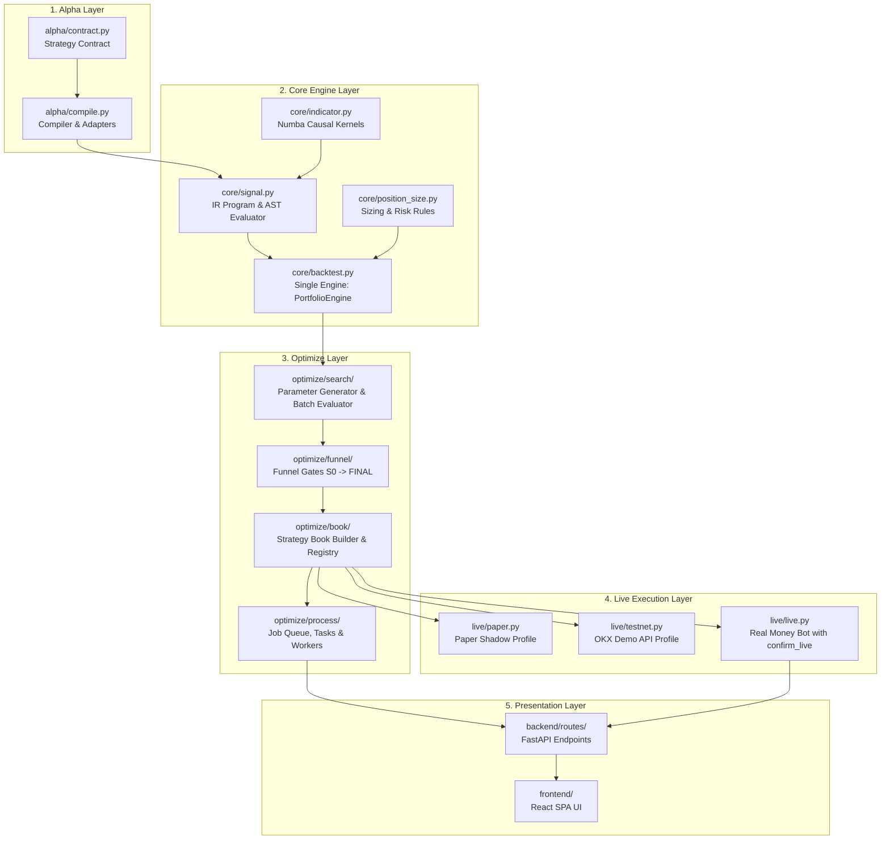

# Thành phần hệ thống & Luồng dữ liệu Nora (System Components)

Kiến trúc Nora được thiết kế theo luồng dữ liệu 5 tầng một chiều rõ ràng:
$$\text{Alpha} \longrightarrow \text{Core Engine} \longrightarrow \text{Optimize} \longrightarrow \text{Live} \longrightarrow \text{Routes / UI}$$

---

## 1. Sơ đồ luồng tổng quan

---

## 2. Chi tiết trách nhiệm các phân tầng

### 2.1 Alpha Layer (`backend/alpha/`)
- Tiếp nhận chiến lược từ người dùng (Web Studio/Education) hoặc chiến lược hệ thống định nghĩa sẵn.
- Thực thi **Strategy Contract**: Xác thực cấu trúc kế thừa `SimpleAlgorithm`, phương thức `on_start`/`on_bar`/`__algorithm__`, danh sách trắng an toàn.
- Chuyển đổi mã nguồn thành biểu diễn trung gian thống nhất IR (`Program`).

### 2.2 Core Engine Layer (`backend/core/`)
- **Tập hợp kernel chỉ báo causal**: Tính toán các chuỗi kỹ thuật không nhìn trước dữ liệu tương lai.
- **Biên dịch và thực thi tín hiệu**: Tính toán các mặt nạ boolean vector hoá cho tín hiệu vào lệnh (Long Entry) và thoát lệnh (Exit/Stop-Loss).
- **Engine khớp lệnh duy nhất**: Khớp lệnh mô phỏng nến/tick hai pha (Pha 1: Mở nến, Pha 2: Trong nến) triệt tiêu hoàn toàn lookahead bias giữa các tài sản, tính toán chi phí trượt giá, phí giao dịch và funding rate thực tế.

### 2.3 Optimize Layer (`backend/optimize/`)
- **Search**: Sinh lưới quét không gian tham số và điều phối đánh giá phân tán đa tiến trình.
- **Funnel**: Lọc qua các cổng kiểm duyệt chất lượng khắt khe từ S0 (lợi nhuận cơ bản) đến FINAL (vượt qua WFA, Monte Carlo, chống Overfitting).
- **Book Builder**: Tối ưu hoá phân bổ tỷ trọng danh mục và xuất bản cấu hình sổ chiến lược.
- **Process Manager**: Quản lý hàng đợi tác vụ nền bất đồng bộ, khống chế trần bộ nhớ RAM 12GB qua `memwatch`.

### 2.4 Live Execution Layer (`backend/live/`)
- Sử dụng chính cấu hình sổ chiến lược đã được xuất bản để chạy bot thời gian thực.
- Hỗ trợ 3 môi trường:
  - **Paper Trading**: Khớp lệnh mô phỏng trên dòng nến thời gian thực của sàn.
  - **Testnet**: Giao dịch tự động trên môi trường OKX Demo Trading với vốn ảo.
  - **Live Trading**: Giao dịch tài khoản thật với khoá bảo mật `okx.env` và cờ bắt buộc `confirm_live`.

### 2.5 Presentation Layer (`backend/routes/` & `frontend/`)
- Backend cung cấp các API RESTful bất đồng bộ.
- Frontend React SPA nhận dữ liệu cấu hình và kết quả từ backend để hiển thị trực quan (đường vốn, biểu đồ sụt giảm, nhật ký lệnh, Spotlight Walkthrough).
